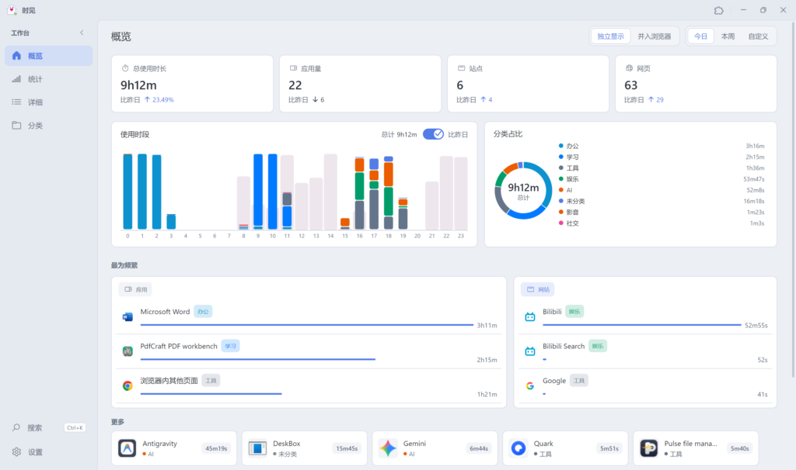
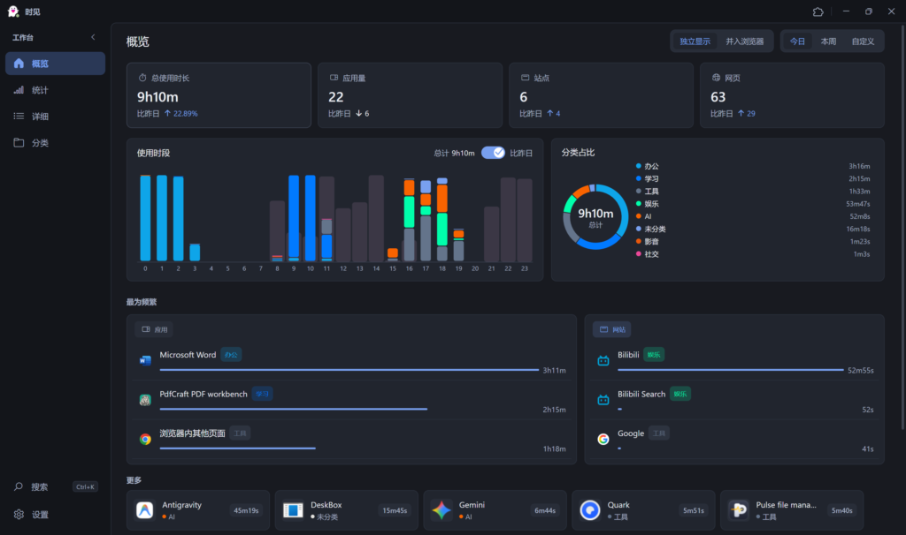
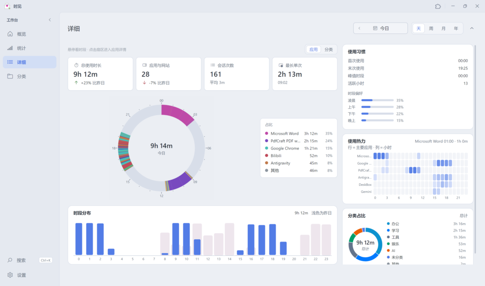
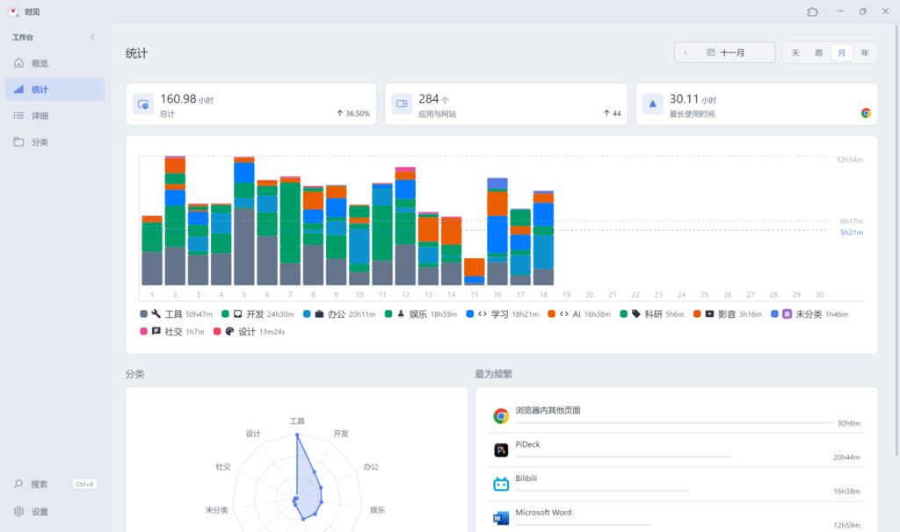
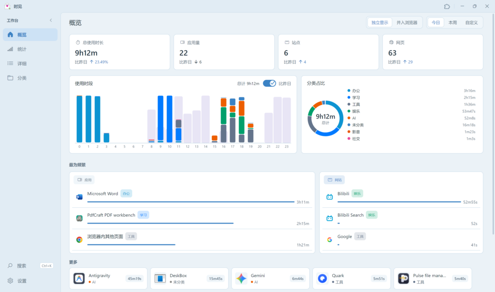
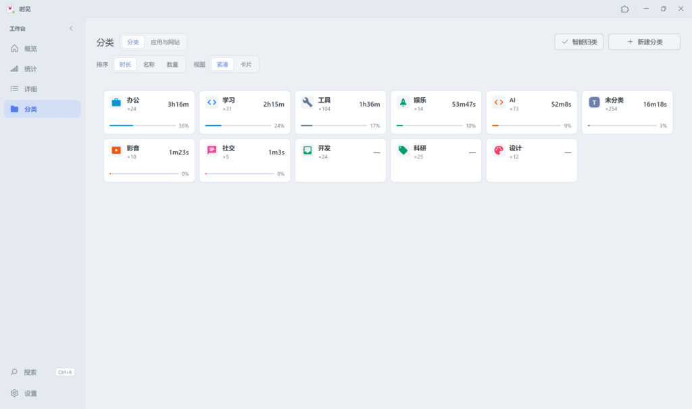
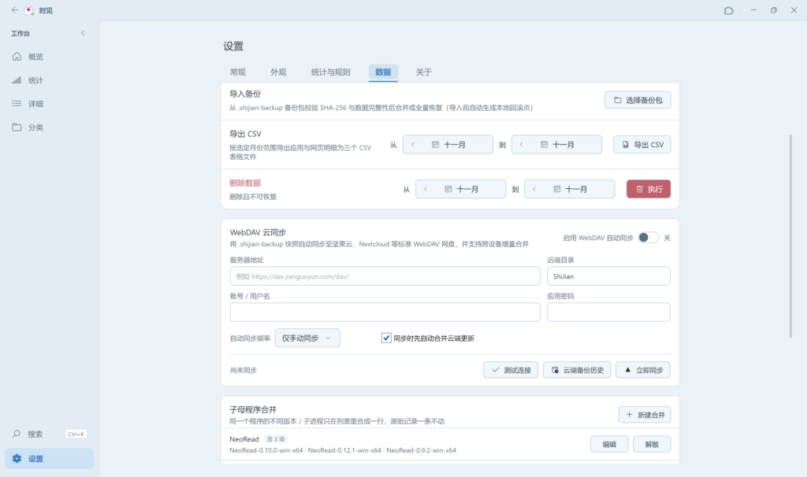
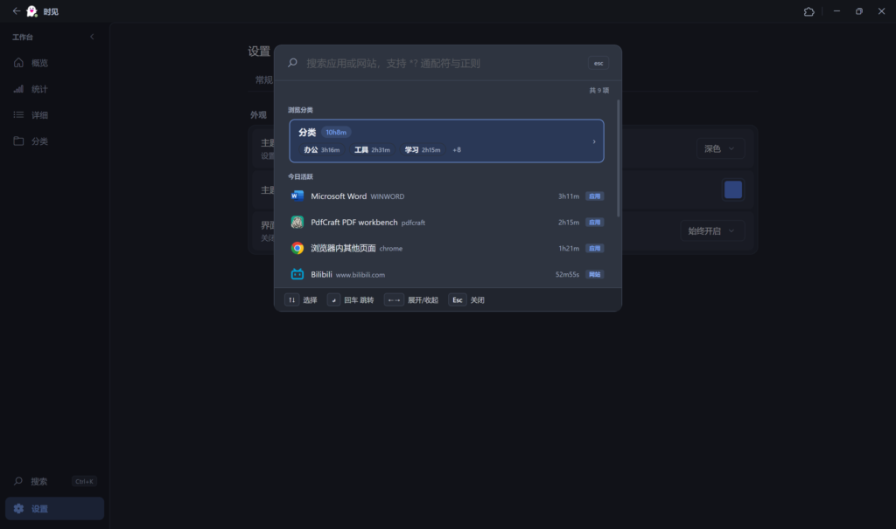
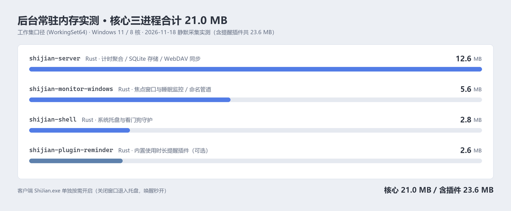

<div align="center">

# 时见 ShiJian

**在你自己的电脑上，安静、清晰地记下每一分钟花在哪个软件和网站。**

简体中文 · [English](README_EN.md)

[](https://github.com/Purestblues/shijian/releases)
[](LICENSE)


</div>

---

**时见（ShiJian）** 是一款**本地优先、零打扰**的桌面屏幕使用时间统计工具，支持 Windows 与 macOS。  
所有使用记录默认**永久保存**在本地 SQLite 数据库中——不强制联网、无需账号、绝不上传隐私数据。

客户端采用 **.NET 10 Native AOT + Avalonia 12** 构建，仅在打开窗口时渲染；后台采集、聚合与守护完全由轻量化 **Rust** 进程承担（macOS 采集端为 Swift），核心三进程常驻内存仅约 **21 MB**。

## 界面预览

> 基于 **ShiJian 2.0**（Nord 极简素雅设计语言）实机截取，提供 **Nord Snow Storm（浅色）**、**Nord Polar Night（极夜深色）** 与 **Nord Frost（北极蔚蓝）** 三套主题。

<p align="center">
  
  
</p>
<p align="center">
  
  
</p>

<details>
<summary>查看更多页面截图（Nord Frost 蔚蓝主题、统一分类、数据备份与 WebDAV、全局搜索）</summary>
<br />
<p align="center">
  
  
</p>
<p align="center">
  
  
</p>
</details>

---

## 核心特点

- **软件 + 网页统一视角**：后台精确捕捉前台焦点窗口与系统睡眠状态；配合浏览器扩展（Manifest V3），按标签页真实活跃时间记录网页访问，支持在概览页一键切换「独立显示 / 并入浏览器」。
- **24 小时环形时钟与习惯洞察**：详细页以环形表盘呈现全天/周/月/年的真实使用时段，配合使用习惯偏好、热力矩阵与分类占比，一眼看清时间流向。
- **全站对比与环比分析**：总览指标与时段柱图支持叠加「昨日 / 上一周期」淡色对比柱，支持自定义起止日期（自动取等长上一区间作环比基准）。
- **统一分类与开箱即用智能归类**：应用与网站共享同一套分类标签，内置 **9 个常用分类**、**32 枚 24×24 SVG 矢量图标**及常见软件/网站匹配规则，支持一键智能归类；全站图表依据 WCAG 相对亮度自适应调整对比度。
- **子母程序自动合并**：自动识别同目录/同发行商的版本变体（如自动更新生成的不同版本号安装程序）并在榜单中折叠合并，也可手动新建或调整混合合并组，原始流水一行不改。
- **永久记录与多端加密同步**：移除历史记录天数限制，默认永久保存；提供基于 SQLite `VACUUM INTO` 的一致性快照备份（`.shijian-backup`，含 SHA-256 校验与导入前自动回滚点）及 **WebDAV 云同步**（兼容坚果云、Nextcloud 等）。
- **轻量、丝滑与无障碍**：基于帧同步指数阻尼的平滑滚动，支持跟随系统「减少动画」一键关闭动效；支持全键盘导航（`Ctrl+K` 全局搜索、`Esc` 返回、方向键切换图表与榜单）。

---

## 功能概览

| 模块 | 核心能力 |
| --- | --- |
| **概览** | 总使用时长 / 应用量 / 站点 / 网页四项指标卡（带环比）；24h 分类堆叠柱图与「比昨日」叠加对比开关；分类占比环形图；「最为频繁」双列榜单与「更多」卡片；周期支持今日 / 本周 / 自定义日期范围；支持网页时长「独立显示 / 并入浏览器」切换 |
| **统计** | 支持天 / 周 / 月 / 年四种粒度；多行自适应分类堆叠柱图（点击柱条直接下钻该时段明细）；分类雷达图与 Top 榜单；参考线标签自动避让防重叠 |
| **详细看板** | **环形时钟**（日=24h 会话扇区、周=7 天、月=当月天数、年=12 个月，悬停看详情、点击进实体页）；时段分布柱图；使用习惯（首末次使用、峰值、时段偏好）；使用热力图（`HeatGrid`）；响应式布局（窄屏自动收起右侧洞察栏以保证表盘直径） |
| **分类** | 应用与网站统一分类标签管理；支持「分类 / 应用与网站」双视图、紧凑/卡片切换与按时长/名称/数量排序；内置常用规则一键「智能归类」 |
| **全局搜索** | 随时 `Ctrl+K` 呼出浮层，支持通配符（`*`、`?`）与正则表达式搜索应用、网站和分类，支持全键盘上下选择与回车跳转 |
| **设置与扩展** | 5 大独立分页（常规 / 外观 / 统计与规则 / 数据 / 关于）；3 套 Nord 主题 + 12 款低饱和预设色板 + 自定义主色；应用/网站正则过滤规则与子母程序合并管理；内嵌 WebUI 管理提醒插件（支持可视化规则与 Lua 脚本） |

---

## 下载与安装

前往 [GitHub Releases](https://github.com/Purestblues/shijian/releases) 下载最新版本（当前正式版：`v2.0`）：

| 平台 | 发布产物 | 说明 |
| --- | --- | --- |
| **Windows (x64)** | `ShiJian-*-Setup.exe` | 图形化安装程序，可自定义安装目录并自动注册开机自启 |
| **Windows (x64)** | `ShiJian-*-win-x64.zip` | 绿色便携版，解压即用；如需开机自启，可在管理员终端运行 `shijian-shell install` |
| **macOS (Apple Silicon)** | `ShiJian-*-macos-arm64.dmg` | 包含 `.app` 与 `ShiJianTools/` 后台安装脚本（*注：CI 已验证构建通路，暂未在 macOS 实机长期实测*） |

### 后台进程与托盘

首次启动后，系统托盘会出现时见图标。后台服务 `shijian-server` 与焦点监控 `shijian-monitor` 由看门狗 `shijian-shell` 自动拉起与守护，**无需也不要手动单独启动**。关闭客户端主窗口时程序会退入托盘，再次唤醒可秒开。

### 浏览器扩展（网页时长统计）

仓库内 `shijian-browser-extension/` 提供了 Manifest V3 扩展（**ShiJian Web Sentry**，支持 Chrome / Edge / Firefox / Safari）：

1. 若从源码构建，先在 `shijian-browser-extension/` 下执行 `npm ci && npm run build`（或直接选用其构建产物目录 `dist/chrome`）。
2. 在浏览器打开 `chrome://extensions`（或 Edge `edge://extensions`）→ 开启**开发者模式** → 点击**加载已解压的扩展程序**，选择 `dist/chrome` 目录。
3. 扩展通过本地 WebSocket（默认 `127.0.0.1:8908`）将标签页活跃时间实时推送给 `shijian-server`。

---

## 架构与资源占用

### 进程架构

```text
ShiJian.exe (.NET 10 AOT + Avalonia 12)   ← 纯桌面 UI，随开随关
        │ HTTP  http://127.0.0.1:37091
        ▼
shijian-server (Rust · Axum + SQLite)     ← 计时聚合、备份、WebDAV 同步、托管 WebUI
        ▲ 命名管道 / IPC            ▲ WebSocket :8908
        │                           │
shijian-monitor (Rust / Swift)   浏览器扩展 (ShiJian Web Sentry)
  窗口焦点与睡眠监控                 网页标签活跃时长采集
        ▲
        │ 拉起并守护（含内置插件进程）
shijian-shell (Rust)                      ← 系统托盘 + 看门狗
```

### 仓库模块

| 目录 / 组件 | 技术栈 | 职责 |
| --- | --- | --- |
| [`ShiJian.Client`](ShiJian.Client) | C# / .NET 10 AOT / Avalonia 12.1.1 | 跨平台桌面客户端界面（316 个 `.cs`、68 个 `.axaml`） |
| [`shijian-server`](shijian-server) | Rust / Axum / SQLx (SQLite) | 数据采集聚合、REST API、`.shijian-backup` 快照与 WebDAV 同步 |
| [`shijian-monitor-windows`](shijian-monitor-windows) / [`shijian-monitor-macos`](shijian-monitor-macos) | Rust (Win32) / Swift (macOS) | 监听前台窗口切换、应用发布者信息与系统休眠事件 |
| [`shijian-shell`](shijian-shell) | Rust | 托盘图标、看门狗守护及插件生命周期管理 |
| [`shijian-browser-extension`](shijian-browser-extension) | TypeScript / esbuild | 浏览器扩展（Chrome / Firefox / Safari） |
| [`shijian-webui`](shijian-webui) | Svelte 5 / Vite 6 | 浏览器中或内置访问的插件配置管理面板 |
| [`shijian-plugins`](shijian-plugins) / [`shijian-plugin-sdk`](shijian-plugin-sdk) | Rust | 插件 SDK 与内置「使用时长提醒」插件（可视化规则 + Lua） |
| [`shijian-installer`](shijian-installer) | Rust / tao + wry | Windows GUI 安装器与 macOS DMG 打包脚本 |
| [`ShiJian.Tests`](ShiJian.Tests) | xunit v3 + Avalonia.Headless | 202 个自动化单元测试与无头 UI 回归测试 |

### 后台内存占用实测

Windows 11（8 逻辑核）静默后台采集状态下实测（WorkingSet64，2026-11-18）：核心三进程合计 **21.0 MB**（含可选提醒插件共 **23.6 MB**）：



---

## 从源码构建与测试

### 环境依赖

- [.NET 10 SDK](https://dotnet.microsoft.com/)
- [Rust 工具链](https://rustup.rs/)（Windows 上需要 VS Build Tools / MSVC 链接器；macOS 监控端需 Swift）
- [Node.js 22+](https://nodejs.org/)（仅构建 `shijian-webui`、浏览器扩展或插件 UI 时需要）

### 常用开发命令

```powershell
# 1. 运行测试（202 个用例）
dotnet test ShiJian.Tests/ShiJian.Tests.csproj -c Release

# 2. 本地一键调试预览客户端
.\script\dev-run.ps1 -ClientOnly     # 快速构建调试版客户端并连接本机已有服务端
.\script\dev-run.ps1                 # 连同本地 shijian-server 一起编译拉起（会临时替换安装版后台）
.\script\dev-run.ps1 -Stop           # 停止调试环境并恢复安装版服务

# 3. 单独构建 Rust 后台组件（各 crate 独立）
cd shijian-server && cargo build --release
cd ../shijian-monitor-windows && cargo build --release
cd ../shijian-shell && cargo build --release
```

> **提示**：Debug 版客户端默认没有单实例互斥锁，可与正式安装版共存调试；运行 `dev-run.ps1` 时若调试目录图标为空，脚本会自动从默认安装目录复制 `Data/AppIcons` 与 `WebFavicons`（安装路径不同可通过 `-InstallDir` 指定）。

---

## 常见问题

<details>
<summary><strong>1. 客户端提示「无法连接到服务端」怎么办？</strong></summary>

`shijian-server` 与 `shijian-monitor` 由 `shijian-shell` 自动拉起并看门狗守护，请先确认系统托盘中 `shijian-shell` 正在运行。

- **开机自启异常**：Windows 可检查任务计划程序中的 `ShiJianShell` 任务路径是否与当前目录一致，或用管理员终端执行 `shijian-shell install` 重新注册；macOS 可运行 `/Applications/ShiJianTools/install-launchagent.sh`。
- **端口冲突**：服务端默认监听 `127.0.0.1:37091`，浏览器扩展 WebSocket 监听 `8908`。若 `37091` 被占用，可设置环境变量 `SHIJIAN_SERVER`（例如 `http://127.0.0.1:37100`，客户端与服务端均会读取）。
- **查看日志**：日志按 `shijian-server.YYYY-MM-DD.log` 按天滚动，macOS 位于 `~/Library/Logs/ShiJian/`，Windows 位于程序目录的 `Logs\` 下（可用 `SHIJIAN_LOG_DIR` 覆盖）。

</details>

<details>
<summary><strong>2. 如何备份或在不同电脑间同步数据？</strong></summary>

进入 **设置 → 数据**：
- **本地快照备份**：点击「导出备份」生成 `.shijian-backup` 归档包（含 SQLite `VACUUM INTO` 事务一致性快照、图标资源与 SHA-256 校验清单）。恢复时支持**合并（Merge）**与**全量覆盖（Replace）**，并在导入前自动生成本地安全回滚点。
- **WebDAV 云同步**：填写坚果云、Nextcloud 等标准 WebDAV 地址与应用密码，支持连接测试、手动同步、按启动/每小时/每天自动同步以及跨设备增量合并。

</details>

<details>
<summary><strong>3. 关于项目起源与从 Taix 改名为 ShiJian 的迁移说明</strong></summary>

- **项目起源**：本仓库最早 fork 自 [NLick47/Taix](https://github.com/NLick47/Taix)（上游 [Tai](https://github.com/Planshit/Tai) 的 .NET + Avalonia + Rust 跨平台重构版）。自 2026-11 起项目更名为**时见（ShiJian）**，在完成实体模型统一、N14 Nord 设计语言全面重构与 2.0 正式版发布后，已作为独立项目演进并停止同步上游。
- **旧版数据迁移**：从 `Taix` 升级至 `ShiJian` 时，Windows Setup 安装器会自动迁移旧安装目录的 `Data/` 并清理旧自启任务；macOS 服务端启动时会自动将 `~/Library/Application Support/Taix` 缺失条目补全至 `ShiJian`。环境变量已由 `TAIX_SERVER` / `TAIX_LOG_DIR` 更名为 `SHIJIAN_SERVER` / `SHIJIAN_LOG_DIR`。

</details>

---

## 开源许可

本项目沿用并保留上游 [MIT License](LICENSE)。
