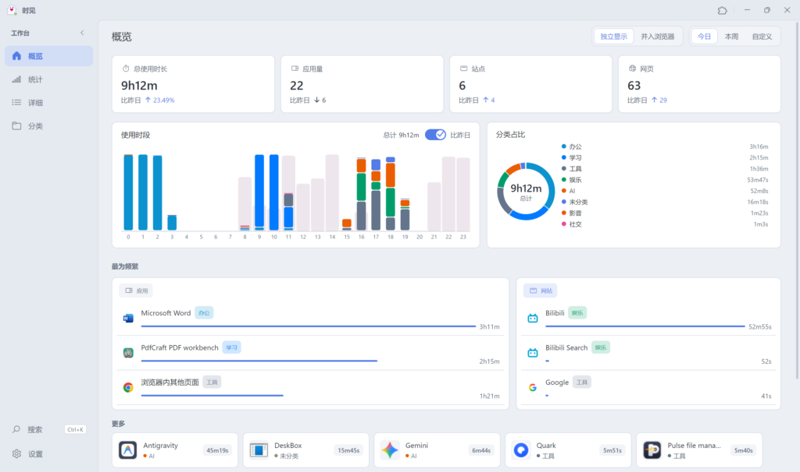
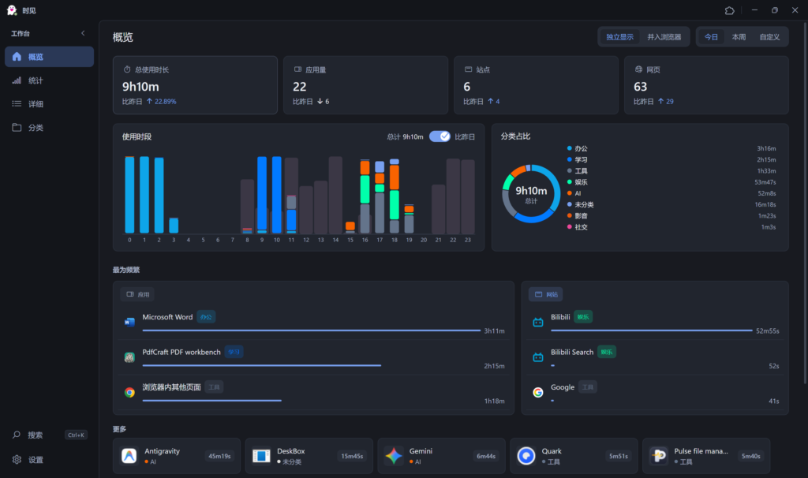
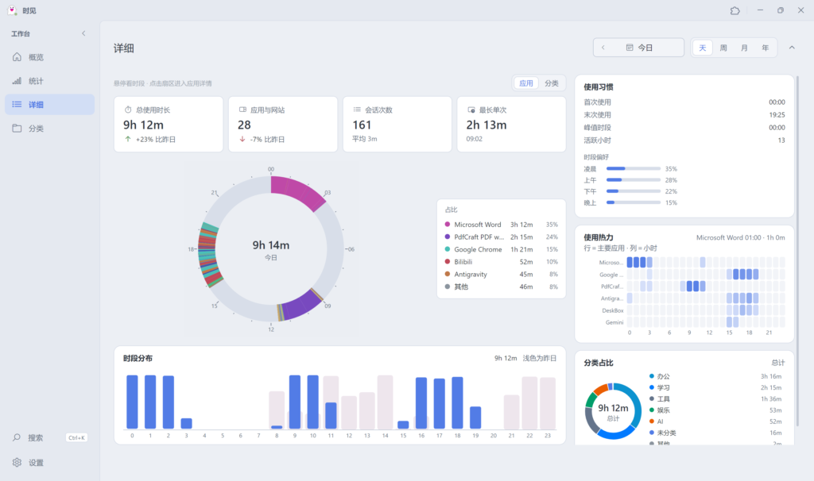
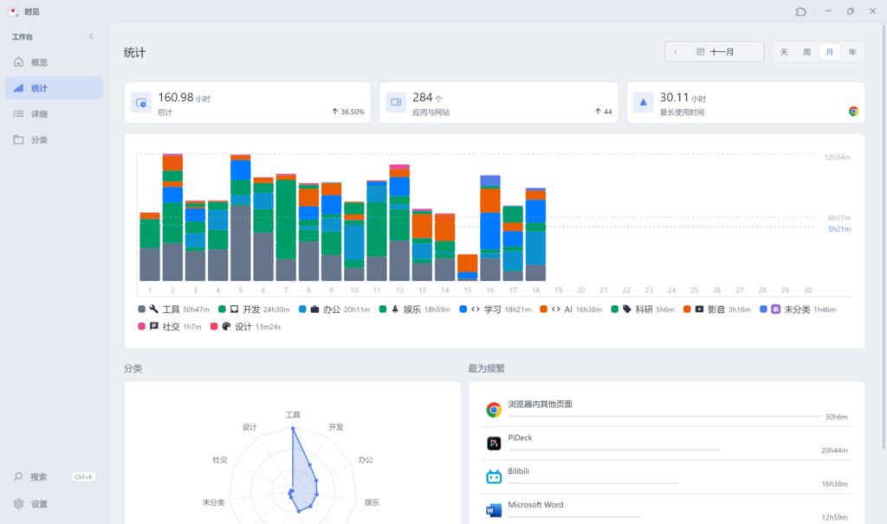
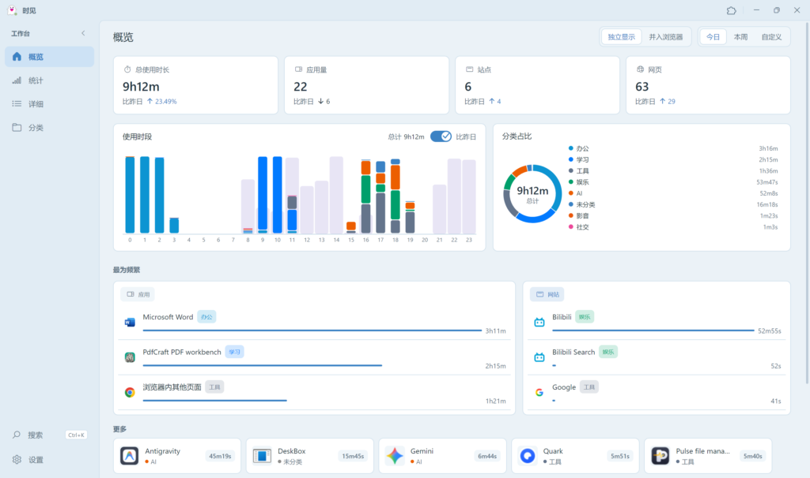
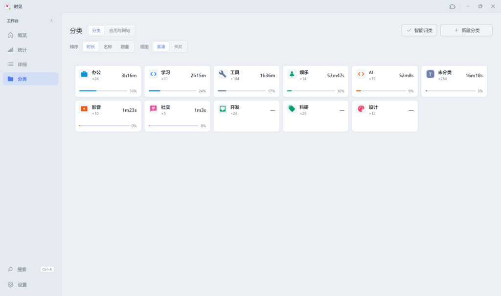
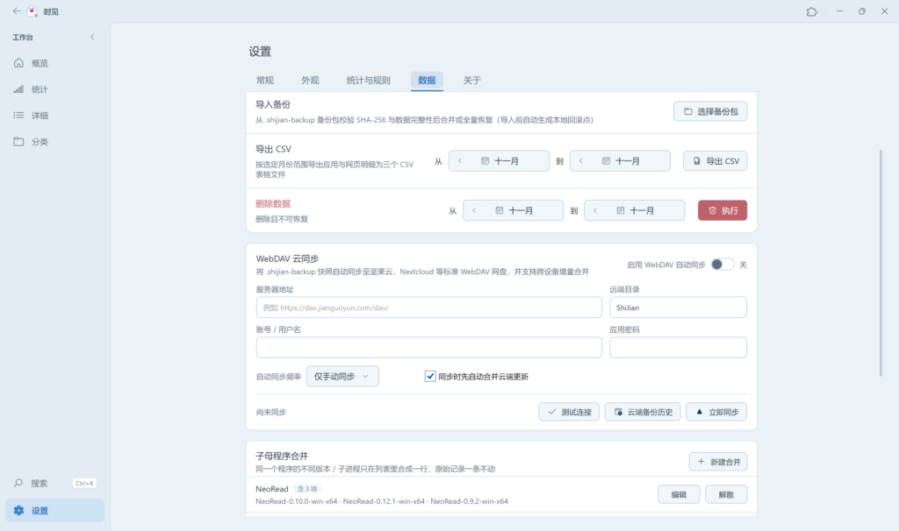
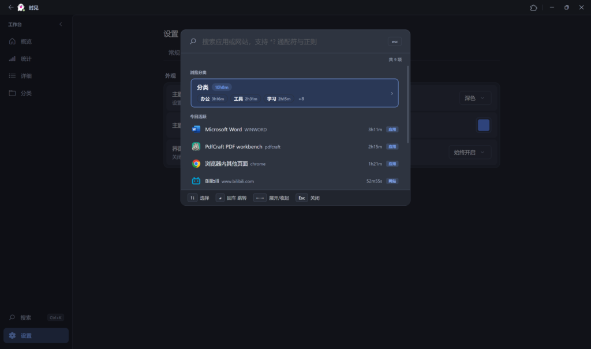
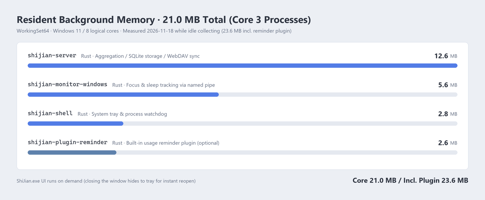

<div align="center">

# ShiJian (时见)

**Track every minute spent across your apps and websites — quietly, cleanly, and locally on your own machine.**

[简体中文](README.md) · English

[](https://github.com/Purestblues/shijian/releases)
[](LICENSE)


</div>

---

**ShiJian** is a **local-first, zero-distraction** screen-time tracker for Windows and macOS.  
All usage history is stored **permanently** in a local SQLite database by default — no accounts, no mandatory cloud connection, and no telemetry.

The desktop UI is built with **.NET 10 Native AOT + Avalonia 12** and runs on demand. All background tracking, aggregation, and supervision are handled by lightweight **Rust** services (Swift on macOS), consuming only ~**21 MB** of resident memory across the three core background processes.

## Screenshots

> Captured on **ShiJian 2.0** (redesigned with the Nord minimalist design system), featuring **Nord Snow Storm (Light)**, **Nord Polar Night (Dark)**, and **Nord Frost (Ice)** themes.

<p align="center">
  
  
</p>
<p align="center">
  
  
</p>

<details>
<summary>More screenshots (Nord Frost theme, Unified Categories, Data Backup & WebDAV, Global Search)</summary>
<br />
<p align="center">
  
  
</p>
<p align="center">
  
  
</p>
</details>

---

## Key Highlights

- **Unified App + Website Tracking**: Captures foreground window switches and system sleep events natively. Paired with the Manifest V3 browser extension, web browsing is measured by actual active tab time and can be toggled between **Standalone** and **Merged into Browser** directly on the Overview page.
- **24-Hour Clock Ring & Habit Insights**: The Detail dashboard renders real usage sessions along a circular dial (day / week / month / year), alongside habit summaries, activity heatmaps, and category breakdowns.
- **Period-over-Period Comparison**: KPI cards and hourly/daily bar charts overlay faded comparison bars for yesterday or the previous equal-length custom date range.
- **Unified Categories & Smart Auto-Categorization**: Applications and websites share a single category system, shipping out of the box with **9 built-in categories**, **32 custom 24×24 SVG icons**, and pattern rules for one-click auto-categorization. Chart colors automatically adapt to WCAG relative luminance contrast on both light and dark themes.
- **Automatic Parent/Child App Grouping**: Automatically groups installer variants and versioned executables sharing the same install directory or publisher (without altering raw records), and supports custom mixed merge groups.
- **Permanent History, Snapshot Backups & WebDAV Sync**: No artificial retention cap — data is kept permanently. Export/import consistent `.shijian-backup` archives (SQLite `VACUUM INTO` + icons + SHA-256 verification with automatic pre-import rollback snapshots), export monthly CSVs, or sync incrementally via **WebDAV** (Nextcloud, Jianguoyun, etc.).
- **Smooth & Accessible**: Frame-synced damped smooth scrolling, system "Reduce Motion" integration, and full keyboard navigation (`Ctrl+K` search palette, `Esc` back navigation, arrow keys for tabs, charts, and rankings).

---

## Feature Overview

| Section | Capabilities |
| --- | --- |
| **Overview** | 4 KPI cards (Total Time / Apps / Sites / Pages with deltas); hourly stacked bar chart with comparison toggle; category donut chart; Top Apps & Websites lists plus "More" cards; Today / Week / Custom date ranges; Standalone vs. Browser-Merged toggle |
| **Statistics** | Day / Week / Month / Year granularities; multi-row stacked column chart with drill-down on click; category radar chart & rankings; smart collision avoidance on reference line labels |
| **Detail Dashboard** | **Clock Ring** (24h sessions for Day, hourly/daily/monthly buckets for Week/Month/Year); period distribution bars; usage habits (first/last active, peak hour, time-of-day bias); `HeatGrid` heatmaps; responsive layout that preserves dial diameter on narrower windows |
| **Categories** | Unified app & website categories; Category / Entities dual view; Compact / Card view switch; sorting by duration, name, or count; built-in one-click Smart Categorize |
| **Global Search** | `Ctrl+K` command palette supporting wildcards (`*`, `?`) and regex across apps, websites, and categories with full keyboard navigation |
| **Settings & Plugins** | 5 dedicated tabs (General / Appearance / Tracking & Rules / Data / About); 3 Nord themes + 12 muted preset accents + custom color picker; regex ignore/merge rules; embedded WebUI for configuring plugins such as the built-in Usage Reminder (visual rules or Lua scripts) |

---

## Download & Installation

Download the latest release (`v2.0`) from [GitHub Releases](https://github.com/Purestblues/shijian/releases):

| Platform | Artifact | Notes |
| --- | --- | --- |
| **Windows (x64)** | `ShiJian-*-Setup.exe` | GUI installer with custom install path and auto-start registration |
| **Windows (x64)** | `ShiJian-*-win-x64.zip` | Portable archive; optionally run `shijian-shell install` in an elevated terminal to register auto-start |
| **macOS (Apple Silicon)** | `ShiJian-*-macos-arm64.dmg` | Includes `.app` and `ShiJianTools/` helper scripts (*CI build verified; not yet extensively tested on physical Apple Silicon hardware*) |

### Background Services & Tray

After launching ShiJian, its icon lives in the system tray. `shijian-shell` acts as the watchdog that starts and supervises `shijian-server` and `shijian-monitor`, so **you do not need to launch backend binaries manually**. Closing the main window minimizes to tray for instant reopen.

### Browser Extension (Web Tracking)

The Manifest V3 extension (**ShiJian Web Sentry**, supporting Chrome / Edge / Firefox / Safari) is located in `shijian-browser-extension/`:

1. To build from source, run `npm ci && npm run build` inside `shijian-browser-extension/` (outputs to `dist/chrome`, `dist/firefox`, `dist/safari`).
2. Open `chrome://extensions` (or `edge://extensions`), enable **Developer mode**, and click **Load unpacked** pointing to `dist/chrome`.
3. The extension streams active tab durations to `shijian-server` over local WebSocket (default `127.0.0.1:8908`).

---

## Architecture & Footprint

### Process Architecture

```text
ShiJian.exe (.NET 10 AOT + Avalonia 12)   ← On-demand desktop UI
        │ HTTP  http://127.0.0.1:37091
        ▼
shijian-server (Rust · Axum + SQLite)     ← Aggregation, backups, WebDAV sync, embedded WebUI
        ▲ Named Pipe / IPC          ▲ WebSocket :8908
        │                           │
shijian-monitor (Rust / Swift)   Browser Extension (ShiJian Web Sentry)
  Focus & sleep monitoring         Active web tab tracking
        ▲
        │ Launches & supervises (including built-in plugins)
shijian-shell (Rust)                      ← System tray + watchdog
```

### Repository Modules

| Module | Stack | Responsibility |
| --- | --- | --- |
| [`ShiJian.Client`](ShiJian.Client) | C# / .NET 10 AOT / Avalonia 12.1.1 | Cross-platform desktop UI (316 `.cs` files, 68 `.axaml` files) |
| [`shijian-server`](shijian-server) | Rust / Axum / SQLx (SQLite) | Tracking ingestion, REST API, `.shijian-backup` snapshots & WebDAV sync |
| [`shijian-monitor-windows`](shijian-monitor-windows) / [`shijian-monitor-macos`](shijian-monitor-macos) | Rust (Win32) / Swift (macOS) | Foreground window focus, publisher metadata & system sleep monitoring |
| [`shijian-shell`](shijian-shell) | Rust | System tray icon, process watchdog & plugin lifecycle |
| [`shijian-browser-extension`](shijian-browser-extension) | TypeScript / esbuild | Browser extension (Chrome / Firefox / Safari) |
| [`shijian-webui`](shijian-webui) | Svelte 5 / Vite 6 | Embedded WebUI for plugin configuration |
| [`shijian-plugins`](shijian-plugins) / [`shijian-plugin-sdk`](shijian-plugin-sdk) | Rust | Plugin SDK & built-in Usage Reminder plugin (visual rules + Lua) |
| [`shijian-installer`](shijian-installer) | Rust / tao + wry | Windows GUI installer & macOS DMG packaging |
| [`ShiJian.Tests`](ShiJian.Tests) | xunit v3 + Avalonia.Headless | 202 automated unit & headless UI tests |

### Resident Memory Footprint

Measured on Windows 11 (8 logical cores, 2026-11-18, `WorkingSet64`) while idle collecting in the background: **21.0 MB** across the 3 core processes (**23.6 MB** including the optional reminder plugin):



---

## Building from Source & Testing

### Prerequisites

- [.NET 10 SDK](https://dotnet.microsoft.com/)
- [Rust toolchain](https://rustup.rs/) (VS Build Tools / MSVC linker on Windows; Swift on macOS)
- [Node.js 22+](https://nodejs.org/) (needed for `shijian-webui`, browser extension, or plugin UI)

### Common Commands

```powershell
# 1. Run test suite (202 tests)
dotnet test ShiJian.Tests/ShiJian.Tests.csproj -c Release

# 2. Launch local debug client
.\script\dev-run.ps1 -ClientOnly     # Build & run Debug client against existing local server
.\script\dev-run.ps1                 # Build & run both local shijian-server and Debug client
.\script\dev-run.ps1 -Stop           # Stop debug environment and restore installed service

# 3. Build Rust backend crates individually (no root workspace)
cd shijian-server && cargo build --release
cd ../shijian-monitor-windows && cargo build --release
cd ../shijian-shell && cargo build --release
```

---

## FAQ & Project Notes

<details>
<summary><strong>1. Client shows "Unable to connect to server"</strong></summary>

`shijian-server` and `shijian-monitor` are managed by `shijian-shell`. Ensure `shijian-shell` is running in the system tray.

- **Auto-start**: On Windows, check the `ShiJianShell` scheduled task or run `shijian-shell install` in an elevated terminal. On macOS, run `/Applications/ShiJianTools/install-launchagent.sh`.
- **Port conflict**: Default HTTP port is `37091` (`127.0.0.1:37091`) and WebSocket port is `8908`. Override the HTTP endpoint via `SHIJIAN_SERVER` (e.g., `http://127.0.0.1:37100`).
- **Logs**: Daily rotating logs (`shijian-server.YYYY-MM-DD.log`) are stored in `~/Library/Logs/ShiJian/` on macOS or `<app_dir>\Logs\` on Windows (overridable via `SHIJIAN_LOG_DIR`).

</details>

<details>
<summary><strong>2. Origin, Attribution & Taix → ShiJian Migration</strong></summary>

- **Origin**: This repository originally forked from [NLick47/Taix](https://github.com/NLick47/Taix) (a .NET + Avalonia + Rust port of [Planshit/Tai](https://github.com/Planshit/Tai)). Since November 2026, following the unified entity model, full Nord UI redesign (N14), and the `2.0` release, the project has been renamed to **ShiJian (时见)** and evolves independently without upstream sync.
- **Migration from Taix**: The Windows Setup installer automatically migrates `Data/` from legacy Taix installations and cleans up old auto-start entries; on macOS, `shijian-server` copies missing entries from `~/Library/Application Support/Taix` into `ShiJian` on startup. Environment variables were renamed from `TAIX_SERVER` / `TAIX_LOG_DIR` to `SHIJIAN_SERVER` / `SHIJIAN_LOG_DIR`.

</details>

---

## License

Licensed under the [MIT License](LICENSE), preserving upstream copyright and attribution.
