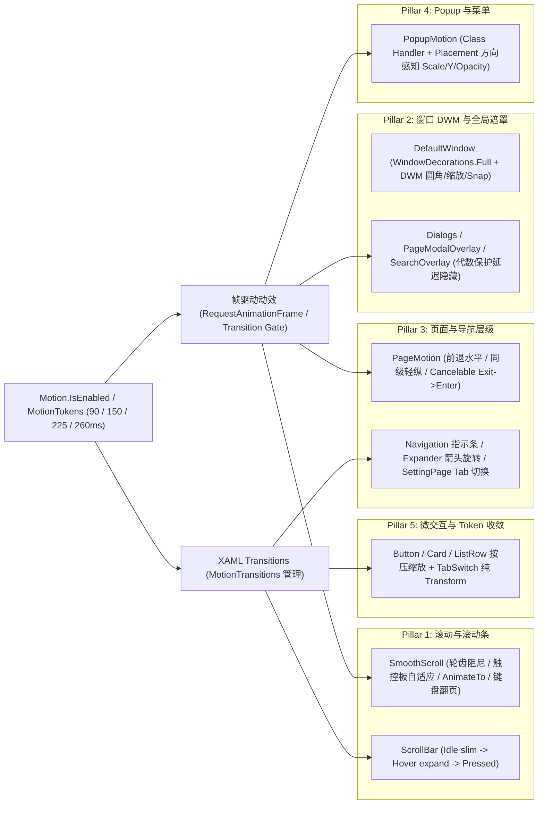
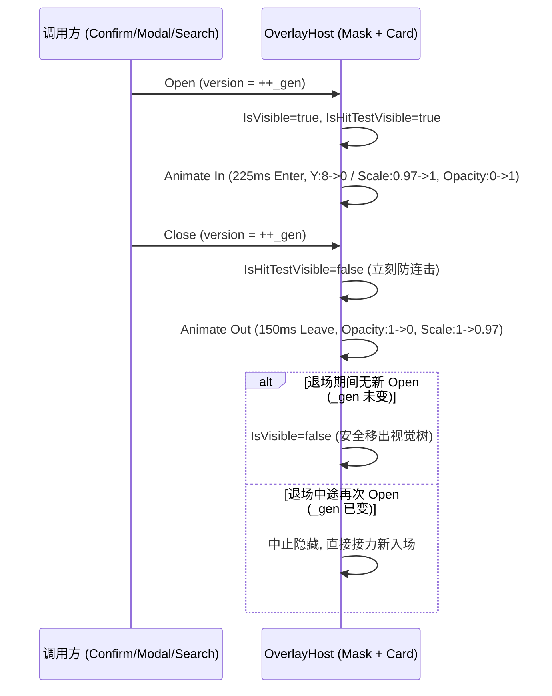

# ShiJian（时见）交互反馈与动效重设计方案

> [!NOTE]
> **文档定位**：本文档为 `ShiJian.Client` 全栈交互反馈与动效体系重设计方案（涵盖平滑滚动与滚动条、Windows 原生 DWM 窗口缩放过渡与全局浮层、方向感知页面与导航层级、Popup 弹出体系、触感微交互及 `MotionTokens` 全量收敛）。
> **当前状态**：已完成系统性审计与方案定稿（2026-11-15），**尚未开工实施**，待后续指令后按本方案执行。

---

## 一、现状诊断与第一性原理设计准则

基于对 `ShiJian.Client`（.NET 10.0 / `Avalonia 12.1.1` / `Avalonia.Themes.Simple`）全量源码与运行环境的审计，当前交互显得“生硬、直来直去”的核心根因如下：

1. **鼠标滚轮平滑滚动几乎不可感知**：[SmoothScroll.cs](../ShiJian.Client/Librarys/SmoothScroll.cs) 已在 `MainWindow` 注册，但 `DecayRate = 18.0` 导致第 1 帧（16.7ms）即跳走 26%（约 `22px`）、`~166ms` 内几乎归零，离散滚轮刻度的过渡短到人眼误以为是直接跳变；高精度触控板微增量共用重阻尼反而显迟滞；且 [PageContainer.cs](../ShiJian.Client/Controls/PageContainer.cs)、[ScrollSectionNavigator.cs](../ShiJian.Client/Controls/ScrollSectionNavigator.cs)、[CategoryPage.axaml.cs](../ShiJian.Client/Views/CategoryPage.axaml.cs) 均直接覆写 `ScrollViewer.Offset`，完全绕过平滑插值。
2. **窗口放大/缩小直来直去**：[DefaultWindow.ApplyWindowChromeMode](../ShiJian.Client/Controls/Window/DefaultWindow.cs#L296-L309) 将 Windows 设为 `WindowDecorations = WindowDecorations.None` 并在 [DefaultWIndow.axaml](../ShiJian.Client/Themes/Window/DefaultWIndow.axaml) 中用 `Margin="16"` 模拟阴影。剥离 `WS_CAPTION | WS_THICKFRAME | WS_MAXIMIZEBOX` 后，Windows DWM 将其视为无边框矩形（`GetCaptionlessMaximizedRect`），直接禁用系统原生的最大化/还原 GPU 缩放过渡、Win11 原生圆角/阴影与 Snap Layouts；同时 `ToggleWindowState` 手动延迟写回 `Bounds`，与窗口状态切换冲突。
3. **退场动画被同步隐藏截断**：`DialogBorder` / `ActionDialogBorder` / `InputModalBorder`、`PageModalOverlay`、`SearchOverlay` 在关闭时均同步设置 `IsVisible = false`，虽然 XAML 上写了 180ms Transition，但关闭当帧即从渲染树消失。
4. **层级切换无方向感、Popup 无进场、硬编码参数分裂**：`PageContainer` 已区分 `IsBack`，但 [PageMotion.cs](../ShiJian.Client/Librarys/PageMotion.cs) 只有固定 `+8px Y` 进场而无退场与前进/后退方向；`TabSwitch` 用 `Margin`（每帧触发布局计算）而非 `RenderTransform`；全库 `<Popup>` 与 `<ContextMenu>` 均瞬间闪现；多处控件存在 `0.12s` / `0.20s` / `0.35s`、`CubicEaseInOut` 等偏离 [MotionTokens.cs](../ShiJian.Client/Librarys/MotionTokens.cs) 的硬编码。

### 设计准绳（克制精密桌面风）

- **单调减速与对称时间标尺**：全部过渡收敛至 `MotionTokens`（`Xs = 90ms`、`S = 150ms`、`M = 225ms`、`L = 260ms`）与三条三次贝塞尔曲线——`Standard (0.40, 0, 0.20, 1)`、`Enter (0.00, 0, 0.20, 1)`、`Leave (0.40, 0, 1.00, 1)`。不使用弹簧回弹（`BackEaseOut` / overshoot）。
- **只动合成层与轻量属性**：平移动画/滑块/按压缩放优先使用 `RenderTransform` 与 `Opacity`，禁止在热路径上动画 `Margin`、`Padding`。
- **尊重 Avalonia 12 技术边界**：代码驱动 `Avalonia.Animation.Animation` Keyframe 对 `RenderTransform` 会抛出异常并静默跳过（沿用 [SlideMotion.cs](../ShiJian.Client/Librarys/SlideMotion.cs) 的 `RequestAnimationFrame` 帧驱动写 `TranslateTransform` / `ScaleTransform`）；声明式 `<TransformOperationsTransition Property="RenderTransform" ... />` 则由 Avalonia 12 原生支持且可被 [MotionTransitions.cs](../ShiJian.Client/Librarys/MotionTransitions.cs) 在“关闭动效”时自动摘除。
- **零打断安全（可中断 + 尊重减动效）**：所有代码驱动动效（`SmoothScroll`、`PageMotion`、`DialogMotion`、`PopupMotion`、`TabContentMotion`）必须检查 `Motion.IsEnabled`（关闭时零延迟直达终态），并以递增版本号或 `CancellationTokenSource` 防止快速连击错乱。

### 总体架构与状态流



---

## 二、分支柱改造详案

### Pillar 1：滚轮平滑滚动、程序化跳转与滚动条反馈

#### 1. 改写 [SmoothScroll.cs](../ShiJian.Client/Librarys/SmoothScroll.cs) 为双模态“顺滑阻尼流”
- **核心参数与双模态分流**：
  - 将固定单一衰减拆分为两档指数阻尼（`dt` 帧率无关 `1 - Math.Exp(-decay * dt)`）：
    - **离散鼠标滚轮**（`|delta| >= 0.85`）：基础步长 `WheelStepPx = 96.0`，衰减率 `WheelDecayRate = 11.5`（第 1 帧约 `17.5%`，3 帧约 `44%`，`~260ms` 达到 95% 沉降，~300ms 收敛至 `SnapThresholdPx = 0.35`）。加入连续滚轮连击加速曲线：当上一滚轮距今 `< 140ms` 且同向时按 `1.0x -> 1.28x` 线性叠加单次增量，同时上限钳位 `MaxPendingDeltaPx = 900.0`，既跟手又防止长距离甩尾失控。
    - **高精度触控板 / 微增量设备**（`0 < |delta| < 0.85`）：沿用手势高频微增量，采用高阻尼 `PrecisionDecayRate = 28.0`（~95ms 顺滑收敛），消除拖泥带水的滞后感，同时避免锯齿卡顿。
  - **`Motion.IsEnabled == false`**：直接单步加到 `Offset`（尊重系统减动效策略）。
- **新增程序化平滑跳转 API `SmoothScroll.AnimateTo(ScrollViewer sv, Vector targetOffset, TimeSpan? duration = null)` 与 `ScrollBy(ScrollViewer sv, Vector delta)`**：
  - 内部复用统一 `AnimationState`（增加目标曲线模式 `TimedCurve`：使用 `MotionTokens.Enter()`/`Standard()` 与默认 `MotionTokens.M` 225ms，而滚轮继续用无固定终点的 `ExponentialDamping` 模式）。
  - 挂接滚动条滑块按下/拖拽拦截（`PointerPressedEvent` 中若命中的祖先是 `Thumb`/`ScrollBar` 或触发外部滚轮/代码强制设值时立即 `CancelAnimation`），保证用户随时可一把拽住滚动条不回弹。
  - 挂接可选键盘平滑翻页（对主内容区或启用 `SmoothScroll.IsEnabled` 的 `ScrollViewer`，在焦点非 `TextBox`/`TextInput` 可编辑控件时拦截 `PageUp` / `PageDown` / `Home` / `End` 转交 `ScrollBy` / `AnimateTo`）。
- **接入所有直接写 `Offset` 的调用点**：
  - [ScrollSectionNavigator.cs](../ShiJian.Client/Controls/ScrollSectionNavigator.cs)：将第 133 行 `_scrollViewer.Offset = new Vector(...)` 替换为 `SmoothScroll.AnimateTo(_scrollViewer, new Vector(_scrollViewer.Offset.X, targetY))`。
  - [CategoryPage.axaml.cs](../ShiJian.Client/Views/CategoryPage.axaml.cs)：将第 104 行跳转滚动改为 `SmoothScroll.AnimateTo(...)`。
  - [PageContainer.cs](../ShiJian.Client/Controls/PageContainer.cs)：前进打开新页归零直接 `ScrollToHome()`（新页尚未显示）；后退恢复历史滚动位置时，先以瞬间定位恢复避免页面已显示后再大幅跳闪，随后若有锚点微调走 `SmoothScroll.AnimateTo`。

#### 2. 优化 [Common.axaml](../ShiJian.Client/Resources/Themes/Common.axaml) 中的滚动条与滑块反馈
- 目标：弥补 `SimpleTheme` 滚动条生硬问题，对齐桌面端“静息纤细 → 悬停展宽清晰 → 拖动高亮”质感（保留已有 `ScrollBar` 滚动与可拖拽命中宽度）：
  - `Thumb#thumb` / `.FluentScrollBarThumb` 增加 `RenderTransform="scaleX(0.6)"`（Vertical）/`scaleY(0.6)`（Horizontal）静息视觉收窄（保持外层透明轨道宽 `10px` 易命中）、`Opacity: 0.35 -> 0.72 -> 0.92`，轨道背景在 `ScrollBar:pointerover` 时微亮（`0.06` alpha 轨道底色），全部使用 `0:0:0.15` + `0.40,0,0.20,1`。
  - 利用 Avalonia `ScrollBar.IsExpanded`（对应鼠标滑入 `ScrollViewer`/`ScrollBar`）伪类 `:expanded` / `[IsExpanded=True]` 驱动温和显隐（在非活动期以低透明度休眠，滚轮触发或鼠标靠近立刻柔和显现）。

---

### Pillar 2：Windows 原生 DWM 窗口过渡与全局弹窗/遮罩完整生命周期

#### 1. 恢复 Windows 原生 DWM 边框能力与缩放动画
- **技术原理与验证基线**：
  - 已查明 [App.axaml](../ShiJian.Client/App.axaml#L17-L28) 已将 `WindowDrawnDecorations` 的高/框/阴全部清零，因此开启 `WindowDecorations.Full` + `ExtendClientAreaToDecorationsHint = true` 不会多出多余默认标题栏；
  - 已查明 Avalonia 12 `Win32.WindowImpl` 原生内置 `CustomCaptionProc`、`HitTestNCA`、`SetWindowCornerPreference`、`Win32Properties.AddWndProcHookCallback`、`WindowDecorationProperties.ElementRoleProperty`。
- **具体改动**：
  - **[DefaultWindow.cs](../ShiJian.Client/Controls/Window/DefaultWindow.cs)**：
    - 在 `ApplyWindowChromeMode()` 中，当 `UseCustomWindowChrome && OperatingSystem.IsWindows()`：
      - 改设 `WindowDecorations = WindowDecorations.Full;` + `ExtendClientAreaToDecorationsHint = true;` + `ExtendClientAreaTitleBarHeightHint = CustomWindowChromeTitleBarHeight;`（36）；
      - 在 `OnOpened` / 句柄就绪时调用 `Win32Properties.SetWindowCornerPreference(this, Win32Properties.WindowCornerPreference.Round)` 获得 Win11 硬件圆角（最大化时由 DWM 自动取消圆角）；
      - 为模板中的 `TitleBar`、`MinimizeButton`、`MaximizeButton`、`CloseButton` 标定 `WindowDecorationProperties.ElementRole`（及必要时的 `Win32Properties.NonClientHitTestResult`），使标题栏空域既支持双击/拖拽 `WM_NCLBUTTONDBLCLK` / `WM_NCLBUTTONDOWN`，悬停最大化按钮还能触发 Win11 原生 Snap Layouts；同时保留 `TitleBar` 内部交互控件（`BackBtn` 等）为 `Client` 命中区（若实测发现 `HTMAXBUTTON` 拦截 `Button.Click`，通过 `Win32Properties.AddWndProcHookCallback` 兜底处理 `WM_NCLBUTTONUP` 或仅保留 `HTCAPTION` + `WindowChrome`）；
      - 若 Avalonia `WindowImpl` 在 `WS_CAPTION` 下顶部产生 1px 客户区黑线或最大化 7px 溢出偏移，挂接 `Win32Properties.AddWndProcHookCallback` 精确校准 `WM_NCCALCSIZE`，并把 Windows 最大化安全内边距绑定到内容宿主（利用 `Window.WindowDecorationMargin` 或按 `WindowState == Maximized` 应用安全 inset），确保标题栏按钮紧贴屏幕边缘不被裁切。
    - 精简 `ToggleWindowState()`（L766-815）：移除 `DispatcherPriority.Loaded` 后强行重设 `Bounds` 的逻辑，交由 Windows 原生 `ShowWindow(SW_MAXIMIZE / SW_RESTORE)` 播放丝滑缩放过渡，仅负责记录正常的 `Normal` 位置尺寸供冷启动恢复。
  - **[DefaultWIndow.axaml](../ShiJian.Client/Themes/Window/DefaultWIndow.axaml)**：
    - 移除 Windows 原生 DWM 模式下多余的 `WindowBorder Margin="16"`、`Elevation3` 伪阴影以及 `Panel#OuterResizeFrame`（仅保留 1px 内描边或非 DWM 退化分支），窗口四周 0px 死区，最大化切换无边距突跳；
    - 保留 [MacOSWindow.cs](../ShiJian.Client/Controls/Window/MacOSWindow.cs) / [MacOSWindow.axaml](../ShiJian.Client/Themes/Window/MacOSWindow.axaml) 完全独立不动。
  - **[WindowStateTracker.cs](../ShiJian.Client/Servicers/Instances/WindowStateTracker.cs)**：
    - 移除之前因 `Margin="16"` 隐含的 `+32px` 尺寸偏置假设，确保存盘/读盘尺寸基于真实客户区尺寸，避免首次升级后窗口骤缩或偏移。

#### 2. 修复全局遮罩与弹窗退场被立即截断的问题



- **重构 [DefaultWindow.cs](../ShiJian.Client/Controls/Window/DefaultWindow.cs) 三类内置对话框**：
  - `ShowConfirmDialogAsync`、`ShowActionDialogAsync`、`ShowInputModalAsync` 及其 `Hide*`：引入局部生成号 `_dialogGen`（各自或共享模态计数器），隐藏时不再立刻设置 `ToastGrid.IsVisible = false` 与 `*Border.IsVisible = false`；而是立即将 `IsHitTestVisible = false`、`Masklayer.Opacity = 0`、目标卡片 `Opacity = 0` + `RenderTransform = scale(0.97) translateY(6px)`，等待 `MotionTokens.S`（150ms，`Motion.IsEnabled` 为 `false` 则 0ms）后，确认版本号一致再落盘 `IsVisible = false`。
  - 统一 `DefaultWIndow.axaml` 与 `MacOSWindow.axaml` 中 `DialogBorder` / `ActionDialogBorder` / `InputModalBorder` 与 `Masklayer` 的 Transition 到 `MotionTokens`（入场 `0:0:0.225` `0.00,0,0.20,1`，遮罩/退场 `0:0:0.15` `0.40,0,0.20,1`）。
- **重构 [MainWindow.axaml](../ShiJian.Client/Views/MainWindow.axaml) & [MainWindow.axaml.cs](../ShiJian.Client/Views/MainWindow.axaml.cs) 全局浮层**：
  - **`PageModalOverlay`（`SyncPageModalOverlay`）**：将同步切换改为版本保护异步动画（暗色背景遮罩 + `PageModalHost` 从 `translateY(10px) scale(0.975)` + `Opacity 0` 进场，退场淡出缩小后隐藏）。
  - **`SearchOverlay`（命令面板）**：移除直接硬绑的 `IsVisible="{Binding IsSearchOpen}"`，改在 `MainWindow.axaml.cs` 中监听 `IsSearchOpen` 变化，开启时聚焦 `SearchPaletteInput` 并对面板执行 `scale(0.97) translateY(-6px) -> identity` + 遮罩 `Opacity 0 -> 1`（`225ms Enter`），关闭时执行 `150ms Leave` 动画完毕后再置 `IsVisible = false`。

---

### Pillar 3：页面切换方向感、导航层级与折叠交互

#### 1. 方向感知页面过渡（[PageMotion.cs](../ShiJian.Client/Librarys/PageMotion.cs)、[SlideMotion.cs](../ShiJian.Client/Librarys/SlideMotion.cs)、[PageContainer.cs](../ShiJian.Client/Controls/PageContainer.cs)）
- 扩展 `SlideMotion` 增加通用二维+透明度帧动画 `AnimateTransformAndOpacityAsync(Control target, double fromX, double toX, double fromY, double toY, double fromOpacity, double toOpacity, TimeSpan duration, IEasing easing, TimeSpan delay, CancellationToken ct)`。
- 升级 `PageMotion` 为区分**切换语义**与**可取消退场→入场**：
  - 定义 `enum PageTransitionDirection { Replace, Forward, Back }`：
    - **同级侧边栏顶层切换（`Replace`，即从历史栈清空或顶级直切）**：旧页快速轻淡出（`75ms` `Leave`），新页轻量纵移淡入（`Y: +8px -> 0`，`180ms Enter`）。
    - **下钻子页（`Forward`，有前进父子层级入栈且 `!IsBack`）**：旧页轻向左收隐（`X: 0 -> -12px, Opacity: 1 -> 0`，`75ms Leave`），新页从右侧平稳滑入（`X: +18px -> 0, Opacity: 0 -> 1`，`180ms Enter`）。
    - **返回上级（`Back`，`IsBack == true`）**：旧页向右轻撤出（`X: 0 -> +12px, Opacity: 1 -> 0`，`75ms Leave`），上级页从左侧平稳复位（`X: -18px -> 0, Opacity: 0 -> 1`，`180ms Enter`）。
  - 在 `PageContainer` 中维护 `_navigationCts`：连续快速点击导航时，新导航立刻 cancel 上一次的退场/入场动画、跳过剩余退场等待并 `SnapToRest`，绝不卡死或堆叠旧页面。

#### 2. `SettingPage` 五标签页切换动效（[SettingPage.axaml](../ShiJian.Client/Views/SettingPage.axaml) / [SettingPage.axaml.cs](../ShiJian.Client/Views/SettingPage.axaml.cs)）
- 当前 `TabPanelGeneral` ~ `TabPanelAbout` 直接硬绑 `IsVisible="{Binding IsTabNSelected}"`。
- 改为在 `SettingPage.axaml.cs` 中监听选中标签索引变化：比对旧索引与新索引决定水平方向（左切 `-12px`，右切 `+12px`），旧面板以 `MotionTokens.Xs`（90ms `Leave`）淡出后隐藏，新面板立刻随同向 `12px` 轻滑入 + `Opacity 0 -> 1`（`150ms Enter`）；`Motion.IsEnabled == false` 或连击时立即落停终态。

#### 3. 侧栏导航、折叠手风琴与列表交错感
- **`Navigation`（[Navigation.cs](../ShiJian.Client/Controls/Navigation/Navigation.cs)）与 [NavigationItem.axaml](../ShiJian.Client/Themes/Navigation/NavigationItem.axaml)**：
  - 将导航选中指示线（或高光槽位）独立化（`Border#ActiveIndicator` 类似 `TabSwitch` 方案），选中切换时用纯 `RenderTransform translateY(...)` 顺滑滑动到目标项（`MotionTokens.M` 225ms `Standard`），侧栏折叠宽度改变后自动校准位置。
  - [MainWindow.axaml](../ShiJian.Client/Views/MainWindow.axaml#L299-L302) 侧栏 `Width` 过渡统一采用 `Easing="0.40,0,0.20,1"`（`0:0:0.225`）。
- **`Expander`（[Expander.cs](../ShiJian.Client/Controls/Expander/Expander.cs) & [Expander.axaml](../ShiJian.Client/Themes/Expander/Expander.axaml)）**：
  - `Icon#Icon`（箭头）绑定 `RenderTransformOrigin="50%,50%"` 与 `<TransformOperationsTransition Property="RenderTransform" Duration="0:0:0.15" Easing="0.40,0,0.20,1" />`，通过 `[IsExpanded=True]` 样式在 `rotate(0deg)` 与 `rotate(-90deg)`/`rotate(90deg)`（按当前矢量箭头朝向确认）间丝滑旋转；
  - `HeaderBorder` 补齐 `:pointerover` / `:pressed` 背景、边框与微缩放（`scale(0.992)`）过渡。

---

### Pillar 4：Popup、ContextMenu 与 Flyout 弹出体系

#### 1. 新增统一弹出动效附件行为 `[NEW]` [PopupMotion.cs](../ShiJian.Client/Librarys/PopupMotion.cs)
- **为何有效且无裁剪**：Win32 顶层 `<Popup>` / `<ContextMenu>` 窗口句柄背景透明，内容根元素在弹窗尺寸内。进场动画从 `scale(0.96)`（比终态小 4%）+ 偏移 `4px` 放大回 `1.0`，因此动画任何时刻都不会超出原生 Popup HWND 边界而被裁切，也不需 `OverlayPopups` 改造。
- **行为规则**：
  - 通过类级静态事件监听 `Popup.OpenedEvent` 与 `ContextMenu.OpenedEvent`（在 `MainWindow` 初始化或 `EnsureRegistered()` 注册，支持通过 `PopupMotion.IsEnabled="False"` 个别豁免）。
  - 根据 `Placement`（`Top` / `TopEdgeAligned*` 向上自 `+4px -> 0`，`Bottom` / 其余向下自 `-4px -> 0`，`Left` / `Right` 对称水平 `±4px -> 0`）配合对应锚点 `RenderTransformOrigin`，执行 `MotionTokens.S`（150ms，`MotionTokens.Enter()`）进场：`Opacity 0 -> 1`、`Scale 0.96 -> 1.0`、`Translate 4px -> 0`；
  - 对 `<ContextMenu>` / 多级子菜单 `PART_Popup`，额外对可见子菜单项赋予轻缓整体显现，消除生硬闪跳，并在关闭时尊重鼠标轻触立即关闭以防止焦点死锁。
- **全量覆盖清单**（检查并微调各自根节点模板以适配 `PopupMotion` 与边框过渡）：
  - [Common.axaml](../ShiJian.Client/Resources/Themes/Common.axaml)：`ContextMenu`、`MenuItem` 悬停高亮与子菜单 `PART_Popup`
  - [Select.axaml](../ShiJian.Client/Themes/Select/Select.axaml) & [Option.axaml](../ShiJian.Client/Themes/Select/Option.axaml)
  - [DateSelect.axaml](../ShiJian.Client/Themes/Base/DateSelect.axaml) & [DatePickerBar.axaml](../ShiJian.Client/Themes/DatePickerBar/DatePickerBar.axaml)
  - [ColorSelect.axaml](../ShiJian.Client/Themes/Base/ColorSelect.axaml) & [IconSelect.axaml](../ShiJian.Client/Themes/Base/IconSelect.axaml)
  - [InputBox.axaml](../ShiJian.Client/Themes/Input/InputBox.axaml)（校验错误气泡 Popup）
  - [ColumnChart.axaml](../ShiJian.Client/Themes/Charts/ColumnChart.axaml)（柱状图悬浮 Tooltip Popup）
  - [CategoryPage.axaml](../ShiJian.Client/Views/CategoryPage.axaml)（`TagPickerFlyout`）

---

### Pillar 5：触感微交互（按钮/卡片/列表）、布局性能优化与全量 Token 收敛

#### 1. `TabSwitch` 从布局属性迁移至 GPU Transform
- 修改 [TabSwitch.axaml](../ShiJian.Client/Themes/Select/TabSwitch.axaml) 与 [TabSwitch.cs](../ShiJian.Client/Controls/Select/TabSwitch.cs)：
  - 将 `Border#Slider` 上的 `<ThicknessTransition Property="Margin" Duration="0:0:0.20">` 替换为 `<TransformOperationsTransition Property="RenderTransform" Duration="0:0:0.225" Easing="0.40,0,0.20,1" />`（与 `Width` 同用 `MotionTokens.M` `0:0:0.225` 与 `Standard` Easing）；
  - `TabSwitch.cs` 的 `PositionSlider()` 改写 `_slider.RenderTransform = TransformOperations.Parse($"translateX({targetX.ToString(CultureInfo.InvariantCulture)}px)")`，`Margin` 恒为 `0`，消除切换周期时的每帧 Measure/Arrange 开销。

#### 2. 统一 `:pointerover` 与 `:pressed` 触感反馈矩阵
利用声明式 `<Transitions>` 中的 `TransformOperationsTransition`（90ms `Standard`）+ 背景/边框过渡（150ms `Standard`），在各控件基准态声明 `RenderTransform="scale(1)"` 与 `RenderTransformOrigin="50%,50%"`：

| 控件层级 | 目标文件 | `:pointerover` 反馈 | `:pressed` 反馈 |
| --- | --- | --- | --- |
| 常规/图标按钮 | [Button.axaml](../ShiJian.Client/Themes/Button/Button.axaml)、[IconButton.axaml](../ShiJian.Client/Themes/Button/IconButton.axaml) | 背景/边框 `150ms` | `scale(0.97)` (`90ms`) |
| 导航项 & 工具小按钮 | [NavigationItem.axaml](../ShiJian.Client/Themes/Navigation/NavigationItem.axaml)、`MainWindow.axaml` (`.sidebar-search` / `.palette-ghost` / `.palette-esc`) | 背景/边框 `150ms` | `scale(0.965)` (`90ms`) |
| 分段/选项与日历格 | [Option.axaml](../ShiJian.Client/Themes/Select/Option.axaml)、[TabOption.axaml](../ShiJian.Client/Themes/Select/TabOption.axaml)、[DatePickerBarItem.axaml](../ShiJian.Client/Themes/DatePickerBar/DatePickerBarItem.axaml)、[DatePickerGridItem.axaml](../ShiJian.Client/Themes/DatePickerBar/DatePickerGridItem.axaml) | 背景/边框 `150ms` | `scale(0.975)` (`90ms`) |
| 通用卡片 & 统计卡 | [UiKit.axaml](../ShiJian.Client/Themes/Base/UiKit.axaml) (`.card`, `.statCard`, `.listRow`, `ListBox.categoryList`)、[CategoryCard.axaml](../ShiJian.Client/Themes/Category/CategoryCard.axaml) | 边框/底色提亮 `150ms`（可点击项带轻量 `translateY(-1px)`，虚拟化长列表仅变色不位移） | 可点击卡片 `scale(0.988)` (`90ms`) |
| 业务列表项与设置行 | [BaseListItem.axaml](../ShiJian.Client/Themes/List/BaseListItem.axaml)、[SettingPanelItem.axaml](../ShiJian.Client/Themes/SettingPanel/SettingPanelItem.axaml)、[ChartsItemTypeList.axaml](../ShiJian.Client/Themes/Charts/ChartsItemTypeList.axaml)、[SettingPage.axaml](../ShiJian.Client/Views/SettingPage.axaml) (`.shortcut-row`, `.data-row`, `.about-row`) | 补齐缺失的背景/边框过渡 `150ms` | 交互行 `scale(0.992)` (`90ms`) |
| 业务子页与搜索项 | [CategoryPage.axaml](../ShiJian.Client/Views/CategoryPage.axaml)、[CategoryAppListPage.axaml](../ShiJian.Client/Views/CategoryAppListPage.axaml)、[CategoryWebSiteListPage.axaml](../ShiJian.Client/Views/CategoryWebSiteListPage.axaml)、[WebSiteDetailPage.axaml](../ShiJian.Client/Views/WebSiteDetailPage.axaml)、[CategorySummaryPage.axaml](../ShiJian.Client/Views/CategorySummaryPage.axaml) (`.cat-chip`)、[MainWindow.axaml](../ShiJian.Client/Views/MainWindow.axaml) (`SearchResultList`) | 为目前完全无过渡的 `ListBoxItem`/`.tagPill`/`.cat-chip` 补齐 `150ms` 底色/边框过渡 | 胶囊标签/按钮 `scale(0.96)`；列表项 `scale(0.992)` (`90ms`) |

#### 3. 全量硬编码时间与 Easing 收敛
将全库离散的 Duration 与缺失 Easing（特别是以下实测异常项）全部对齐至 `MotionTokens`：
- [IconSelect.axaml](../ShiJian.Client/Themes/Base/IconSelect.axaml#L95-L97)：`0.35`（超标） → `0:0:0.15` + `0.40,0,0.20,1`。
- [DataPage.axaml](../ShiJian.Client/Views/DataPage.axaml#L81-L115)：`CubicEaseInOut` → `0.40,0,0.20,1`（`MotionTokens.Standard()` 语义）；后续评估若无布局冲突可将页边距切换进一步轻量化。
- `Button` / `Select` (`0.12s`)、`Toggle` / `InputBox` / `KeyGestureCapture` / `DatePickerBar` / `Tabbar` / `DefaultWIndow` / `MacOSWindow` (`0.18s` / `0.20s`)：按作用类别分别收敛至 `0:0:0.09`（即时反馈/微按压）、`0:0:0.15`（标准悬停/遮罩/图标切换）、`0:0:0.225`（滑块/面板/侧栏展开）。
- 同时核查 [MotionTransitions.cs](../ShiJian.Client/Librarys/MotionTransitions.cs) 对虚拟化 `ListBoxItem` 挂载后的定期清理逻辑，确保所有新增带 `Transitions` 的样式与控件在“动效模式：关闭”下 100% 瞬间归位。

---

## 三、改动影响评估与关键边界保护

1. **性能与虚拟化安全**：绝不在高频率滚动的长 `ListBox` / `VirtualizingStackPanel` 子项上使用 `Margin`/`Width`/`Height` 动画，亦不自动播放百条级列表重布局波浪动画，仅保留轻量硬件加速属性（`Opacity`、`Background`、`BorderBrush`、`RenderTransform`）。
2. **`MacOSWindow` 兼容性**：Pillar 2 的 Win32 `WindowDecorations.Full` 改造仅在 `UseCustomWindowChrome && OperatingSystem.IsWindows()` 生效，不触碰 `MacOSWindow` 原生标题栏与红绿灯信号。
3. **测试隔离边界**：`Headless` 单元测试环境没有真实 Win32 HWND 与 DWM 合成器，DWM 窗口最大化动画、Win11 圆角与 Snap Layouts 必须通过 `/gui-verify` 真机实窗口交互截图实证，不能只凭单测声称通过。

---

## 四、验证方案 (Verification Plan)

### 1. 单元测试与编译构建（`ShiJian.Tests`）
改造现有测试并新增覆盖：
- **[SmoothScrollTests.cs](../ShiJian.Tests/SmoothScrollTests.cs)**：
  - 模拟连续 60fps 帧步进（验证双模态阻尼曲线：第 1 帧位移占比低于旧参数且 ~300ms 内完成收敛、连击同向叠加速度与上限钳位、触控板微增量高阻尼更快跟手、`Motion.IsEnabled = false` 时 1 帧跳达、`AnimateTo` 精确抵近目标与外部 `CancelAnimation` 终止）。
- **[PageMotionTests.cs](../ShiJian.Tests/PageMotionTests.cs)**：
  - 验证 `Forward` / `Back` / `Replace` 三种方向的偏移符号与最终归位状态（`Opacity = 1`、`RenderTransform` 重置/归零）、快速连击取消前序动画、`Motion.IsEnabled = false` 瞬间就绪。
- **[NEW] 弹窗/遮罩/Popup/TabSwitch 动效单测**：
  - 验证 `Dialog` / `SearchOverlay` 在快速连开-关闭下版本号保护不会误杀新弹窗 `IsVisible`；`TabSwitch` 更新 `RenderTransform` 而 `Margin` 保持 `0`；`PopupMotion` 按不同 `Placement` 计算对应起始偏移与终态还原。
- 执行全量测试：
  ```powershell
  dotnet test ShiJian.Tests/ShiJian.Tests.csproj -c Release --nologo
  ```

### 2. 真机 GUI 自动化与交互实证（`/gui-verify`）
遵循 `AGENTS.md` 规范拉起调试客户端并通过 `gui_controller` 实窗验证：
```powershell
pwsh -File script/dev-run.ps1 -ClientOnly
```
1. **DWM 窗口缩放与标题栏**：`gui_list_windows` → `gui_inspect_window` 定位 `TitleBar` 与最大/最小/关闭按钮 → `gui_capture` 捕获常规态（检查 Win11 圆角、无 16px 外部伪阴影黑边/白边）→ `gui_act` 双击标题栏与点击最大化按钮 → 确认过渡平滑、最大化下内容不被系统边框裁切、按钮位置准确 → 再次双击恢复原始尺寸。
2. **滚轮平滑滚动 & 滚动条反馈**：切入长列表页（如 `Detail` / `DataPage`）执行 `gui_act` 滚轮步进、点击 `ScrollSectionNavigator` 锚点及悬停滚动条，截图比对滚动条悬停加宽与滚动后停靠正确性。
3. **弹窗/模态/Command Palette/Menu**：分别触发 `Ctrl+K` 搜索框、右键 `ContextMenu`、`Select`/`DatePickerBar` 下拉、`ConfirmDialog`，验证开启/关闭后不残留不可点击透明层，焦点正常。
4. **设置“动效：关闭”回归**：切至设置页切换动效开关，验证所有面板与页面切换恢复零延迟瞬时响应。
5. 收尾执行 `gui_close_window` 或 `pwsh -File script/dev-run.ps1 -Stop` 恢复安装版服务并验证 `git status`。
