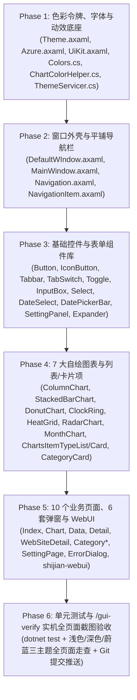

# ShiJian（时见）前端设计语言整体重构详细计划书（N14 蓝图终稿）

> [!IMPORTANT]
> **文档定位**：本文档为 `ShiJian`（时见）项目 **N14 里程碑（前端页面设计语言整体重构）** 的工程级执行蓝图。基于与用户讨论共识，方案全面对齐桌面端 **Material Design** 典范应用 **Super Productivity**（并以其实机 `Nord Snow Storm` 浅色主题、`Nord Polar Night` 深色主题、全局设置页、看板页与任务列表页为直接视觉标杆）。
> **执行状态**：**已于 2026-11-14 全量落地并完成 `/gui-verify` 验证**，作为核心基石随 **ShiJian 2.0 正式版** 发版。本次发版正式废弃历史 `fork.xx` 规则，开启 `2.0` 正式版时代（后续依序为 `2.1`、`2.2`）。

---

## 一、设计总纲与已确认的核心决策

### 1.1 四大核心美学与体验准则
1. **简洁（Concise）**：剔除一切冗余装饰（毛玻璃折射、斜向高光、彩色发光阴影、双重边框、小三角指示器），用纯粹的几何比例与留白组织信息。
2. **素雅且低饱和有活力（Understated & Luminous）**：画布采用温和护眼的冷调雪原白（`#ECEFF4`）与极夜深炭灰（`#181A20`）；品牌色、分类色与语义色全面采用降低纯度（Chroma）但保持明快度的 **Nord Frost & Aurora / Everforest** 调色理念，久看不累、重点突出。
3. **扁平线框卡片与清晰层级（Flat Bordered Hierarchy）**：对齐 Super Productivity `Nord Snow Storm` 的零阴影/微阴影策略——卡片不靠厚重黑影悬浮，而是依靠 **“纯白卡片 `#FFFFFF` 与微冷画布 `#ECEFF4` 的明度差 + `1px` `#D8DEE9` 柔和实线描边 + `8px` 克制圆角”** 建立清晰、干净的桌面级层级。
4. **丝滑流畅（Silky Smooth）**：坚决不引入消耗 GPU 的模糊滤镜（彻底清除 `MonthChart` 中的 `BlurEffect Radius="20"` 等性能毒瘤）与花哨过冲动效（清除 `BackEaseOut`）；全场统一采用 `90ms / 150ms / 225ms` 三档时长与标准 Material 三次贝塞尔曲线。

### 1.2 已拍板的四项关键架构决策
1. **窗口与导航形态**：废弃现有的悬浮毛玻璃胶囊导航舱（`20px` 圆角 + 高光折射 + 发光阴影 + `1.12x` 弹跳放大），改为 **Super Productivity 风格的平铺一体化左侧边栏（Flat Sidebar）**，右侧仅以 `1px` 发丝线与主画布分隔，选中态为柔和胶囊填充（`#D2DEF5` / `#2A3856`）。
2. **默认主题与调色板**：将默认浅色/深色主题基调全面切换为 **`Nord Snow Storm`（浅色）+ `Nord Polar Night`（深色）**，默认主色定为 **矢车菊蓝（Cornflower Frost `#527CE6` / `#78A0F0`）**；改造 `Azure` 主题为基于同一 `Surface` 架构的“北极冰青（Nord Frost）”素雅主题，并移除旧版刺眼的窗口大渐变背景方案。
3. **设置页与通用控件形态**：将 `SettingPage` 重构为对齐 Super Productivity 全局设置页的 **“顶部带 `2px` 底线指示的图标标签栏 + 居中限宽（`MaxWidth="820"`）白底分组大卡 + `#F2F4F8`（`Surface3`）内嵌圆角子卡 + 带 `✓` 对勾的 Material Switch 开关”** 结构。
4. **多端一致性**：桌面端 `ShiJian.Client` 全量重构的同时，同步更新插件管理前端 `shijian-webui/src/app.css` 的 CSS 变量令牌，实现桌面端与内嵌 WebUI 视觉无缝统一。

---

## 二、色彩系统与主题令牌全量规范（Phase 1 底座）

### 2.1 表面层级与墨色令牌对照表（`Resources/Themes/Theme.axaml` & `Azure.axaml`）

| 资源键名 (Resource Key) | 新浅色 `Light` (Nord Snow Storm) | 新深色 `Default/Dark` (Nord Polar Night) | 新蔚蓝 `Azure` (Nord Frost Ice) | 语义与用途说明 |
| :--- | :--- | :--- | :--- | :--- |
| `Surface0Color` / `Surface0Brush` | `#ECEFF4` | `#181A20` | `#EBF2F7` | 主工作区画布底色 (`--bg`) |
| `Surface1Color` / `Surface1Brush` | `#E5E9F0` | `#13151A` | `#E1ECF4` | 左侧导航栏、顶部标题栏底色 (`--sidenav-bg`) |
| `Surface2Color` / `Surface2Brush` | `#FFFFFF` | `#21252E` | `#FFFFFF` | 标准一级卡片表面 (`.card`, `.statCard`, `--card-bg`) |
| `Surface3Color` / `Surface3Brush` | `#F2F4F8` | `#282D38` | `#F0F6FA` | 卡片内嵌子卡、输入框底、`TabSwitch` 槽底、列表斑马底 |
| `Surface4Color` / `Surface4Brush` | `#FFFFFF` | `#2E3440` | `#FFFFFF` | 模态弹窗、下拉菜单 (`Select`/`ContextMenu`)、Tooltip 表面 |
| `WindowContentBackground` | `#ECEFF4` | `#181A20` | `#EBF2F7` | 指向 `Surface0Brush` |
| `StandardBackgroundBrush` | `#F2F4F8` | `#282D38` | `#F0F6FA` | 指向 `Surface3Brush`（次要按钮、内嵌块底） |
| `StandardBackgroundBrush2` | `#FFFFFF` | `#21252E` | `#FFFFFF` | 指向 `Surface2Brush`（卡片主底色） |
| `PopupBackgroundBrush` | `#FFFFFF` | `#2E3440` | `#FFFFFF` | 指向 `Surface4Brush` |
| `SettingPanelBgBrush` | `#FFFFFF` | `#21252E` | `#FFFFFF` | 设置分组卡片底色 |
| `DefaultTextBrush` / `StandardTextBrush` | `#2E3440` | `#ECEFF4` | `#243442` | 一级标题与正文墨色（温和深岩灰 / 雪白） |
| `SubTextBrush` | `#646E82` | `#A5B0C2` | `#5A7184` | 二级说明文字、副标题、表头、坐标轴刻度 |
| `DisabledTextBrush` | `#9AA3B5` | `#687285` | `#92A6B8` | 禁用文本、占位符 (`Placeholder`)、空状态次级提示 |
| `OnBrandBrush` | `#FFFFFF` | `#0F141C` | `#FFFFFF` | 实色主色按钮 (`Button.primary`) 与选中块上的文字颜色 |
| `DividerSubtleBrush` / `CardBorderBrush` | `#D8DEE9` | `#2A303C` | `#CFE0EC` | 卡片 `1px` 描边、侧栏右分割线、列表行分割线 |
| `DividerStrongBrush` / `ButtonBorderBrush` | `#C2CAD8` | `#3B4252` | `#B8CFE0` | 输入框常态描边、次要按钮描边、分段框外描边 |
| `PopupBorderBrush` | `#CFD6E4` | `#3E4656` | `#C2D6E6` | 弹窗与下拉菜单外描边 |
| `HoverBackgroundBrush` / `RowHoverBrush` | `#0C2E3440` | `#12ECEFF4` | `#0C243442` | 通用悬停态叠加色（浅色 5% 墨色 / 深色 7% 墨色） |
| `PressedBackgroundBrush` | `#172E3440` | `#1FECEFF4` | `#17243442` | 按下态叠加色（浅色 9% / 深色 12%） |
| `SelectionPillBrush` / `RowSelectedBrush` | `#D2DEF5` | `#2A3856` | `#CDE2F5` | 侧栏导航选中胶囊底、列表行选中底、标签栏选中浅底 |
| `ScrimBrush` | `#6612151E` | `#80090A0F` | `#66121A24` | 模态弹窗遮罩层（40%~50% 深岩黑，不加模糊滤镜） |
| `ContentGlowTopBrush` | `#00000000` | `#00000000` | `#00000000` | **置为全透明**，彻底移除原浅色紫色光晕 `#26A05DB1` |
| `ContentGlowBottomBrush` | `#00000000` | `#00000000` | `#00000000` | **置为全透明**，保持画布纯粹干净 |

### 2.2 品牌主色、语义状态色与 8 款内置预设（`Base/Color/Colors.cs`）

1. **主色与语义色令牌**：
   - `ThemeColor` / `ThemeBrush`：
     - 浅色默认：`#527CE6`（矢车菊蓝 Cornflower Frost）
     - 深色默认：`#78A0F0`（柔和冰晶蓝）
     - 蔚蓝默认：`#3B82C4`（北极冰海蓝）
   - `ThemeTintBrush`（主色 14% 透明度底，用于 `.tonal` 按钮、徽章底）：浅色 `#24527CE6` / 深色 `#2678A0F0`
   - `SuccessColor` / `SuccessBrush`：浅色 `#5C9A64` / 深色 `#A3BE8C`（对应 `SuccessTintBrush`：`#225C9A64` / `#24A3BE8C`）
   - `WarningColor` / `WarningBrush`：浅色 `#C98A3E` / 深色 `#EBCB8B`（对应 `WarningTintBrush`：`#22C98A3E` / `#24EBCB8B`）
   - `DangerColor` / `DangerBrush`：浅色 `#BF616A` / 深色 `#D6747D`（对应 `DangerTintBrush`：`#22BF616A` / `#24D6747D`）

2. **重构 `Colors.MainColors`（设置页与分类选择器中的预设色板）**：
   彻底删除原有的 `#00FFAB`、`#07FF01`、`#ff1801`、`#fff323` 等刺眼荧光色，替换为 **12 款低饱和活力色（Nord & Everforest 精选色）**：
   ```csharp
   public static readonly string[] MainColors =
   [
       "#527CE6", // 1. 矢车菊蓝 (Cornflower Frost - 默认主色)
       "#5E81AC", // 2. 北极深冰蓝 (Nord Frost Blue)
       "#4D968E", // 3. 松石青绿 (Sage Teal)
       "#689D6A", // 4. 苔原森绿 (Aurora Moss)
       "#8DA101", // 5. 橄榄嫩绿 (Everforest Olive)
       "#C8834B", // 6. 暖砂琥珀 (Warm Ochre)
       "#D08770", // 7. 陶土暖橙 (Aurora Coral)
       "#BF616A", // 8. 柔和绯红 (Aurora Crimson)
       "#B85D82", // 9. 雾玫瑰红 (Dusty Rose)
       "#9D7298", // 10. 雾梅紫 (Aurora Plum)
       "#7E6BC4", // 11. 薰衣草紫 (Muted Lavender)
       "#4C566A", // 12. 极夜岩灰 (Polar Slate)
   ];
   ```

3. **重构 `Colors.TimelinePalette` 与 `ChartColorHelper.cs`**：
   - 将 `Colors.cs` 中动态生成的 `TimelinePalette` 饱和度参数从 `(0.80, 0.72)` 下调至 **`(0.54, 0.48)`**，明度控制在深色 `0.66`、浅色 `0.52`。
   - 将 `ChartColorHelper.cs` 中的兜底常量更新为：
     - `FallbackColor = "#7E8B9B"`（柔和岩灰蓝）
     - `FallbackAccent = "#527CE6"`（矢车菊蓝）
     - `LightBackground = Color.Parse("#ECEFF4")`
     - `DarkBackground = Color.Parse("#181A20")`

---

## 三、几何圆角、光影海拔、字体排印与丝滑动效标尺

### 3.1 圆角标尺（`Resources/Themes/Theme.axaml`）
全面收敛圆角，消除 `16px~20px` 造成的“玩具感/臃肿感”：
- `RadiusXs`：`4`（热力图单元格、柱状图柱顶、图例小色块、进度条细轨）
- `RadiusSmall`：`6`（所有按钮 `Button`、输入框 `InputBox`、下拉触发器 `Select`、列表行悬停块、日期选中格）
- `RadiusMedium`：`8`（**所有标准卡片 `.card`、统计卡 `.statCard`、侧栏导航项 `NavigationItem`、内嵌设置子卡** —— 原为 `16`，现统一改为 `8`）
- `RadiusLarge`：`12`（**主窗口外框 `DefaultWindow`、所有模态弹窗 `Modal`、下拉弹出面板 `Popup`、全局搜索框 `SearchOverlay`** —— 原为 `16/20`，现统一改为 `12`）
- `RadiusPill`：`999`（胶囊徽章 `.pill`、开关轨道 `Toggle`）

### 3.2 阴影与海拔（`Elevation`）
对齐 Super Productivity 的克制光影：
- **标准卡片（`.card` / `.statCard`）**：默认 `BoxShadow="0 1 2 0 #06000000"`（近乎平面的微光影），主要依靠 `#FFFFFF` 表面与 `1px` `CardBorderBrush`（`#D8DEE9` / `#2A303C`）建立清晰边界。
- **`Elevation1`**（可点击卡片悬停态）：`0 2 6 0 #0D000000, 0 1 2 0 #08000000`
- **`Elevation2`**（下拉菜单、日历浮层、图表 Tooltip、Toast）：`0 6 16 -2 #16000000, 0 2 6 -1 #0C000000`（深色下透明度翻倍）
- **`Elevation3`**（模态弹窗 Dialog、`Ctrl+K` 搜索面板）：`0 16 36 -4 #26000000, 0 4 12 -2 #14000000`

### 3.3 字体排印与数字对齐（`Themes/Base/UiKit.axaml`）
- **全局字体栈（`App.axaml`）**：
  `FontFamily="Inter, Segoe UI Variable Text, Segoe UI, HarmonyOS Sans SC, MiSans, PingFang SC, Microsoft YaHei UI, sans-serif"`
- **字号与字重阶梯**：
  1. `.pageTitle`：`FontSize="20" FontWeight="SemiBold" Foreground="{DynamicResource DefaultTextBrush}"`
  2. `.sectionHeader`（新增，用于设置页/详情页大分组标题）：`FontSize="16" FontWeight="SemiBold"`
  3. `.sectionTitle`（卡片/分区小标题）：`FontSize="12" FontWeight="SemiBold" Foreground="{DynamicResource SubTextBrush}"`
  4. `.cardTitle`（卡片内主标题）：`FontSize="14" FontWeight="SemiBold"`
  5. 正文 / 列表行主文本 / 按钮文本：`FontSize="13" FontWeight="Normal"`（重点态 `Medium`）
  6. `.statValue`（KPI 大数字）：`FontSize="22" FontWeight="SemiBold" FontFeatures="tnum"`
  7. `.caption` / `.muted`（辅助说明、坐标刻度）：`FontSize="12" Foreground="{DynamicResource SubTextBrush}"`
- **等宽数字铁律**：凡显示时长（`2h 04m`）、百分比（`42.5%`）、日期、列表右侧数值的 `TextBlock`，一律挂载 `.num` 类或设置 `FontFeatures="tnum"`。

### 3.4 动效清理与丝滑规范（`Librarys/MotionTokens.cs` & 各 XAML）
全场严禁使用 `BackEaseOut`（弹性过冲）和超过 `300ms` 的慢速过渡：
- **微交互（Hover 变色、边框变色）**：`90ms`（`0:0:0.09`），`Standard` 曲线 `(0.4, 0, 0.2, 1)`
- **控件状态切换（Button 按下、Toggle 滑块、Tabbar 指示条、Select 箭头旋转）**：`150ms`（`0:0:0.15`），`Standard` 曲线
- **展开/收起、列表进度条、弹窗进场、页面切换**：`225ms`（`0:0:0.225`），进场 `Enter (0, 0, 0.2, 1)`，退场 `Leave (0.4, 0, 1, 1)`
- **图表首次生长动画（`StackedBarChart` / `DonutChart`）**：统一为 `260ms` `Enter` 曲线（将 `DonutChart.cs` 的 `DurationMs = 620` 改为 `260`）。

---

## 四、窗口外壳与左侧导航栏重构规范（Phase 2）

### 4.1 一体化无框窗口外壳（`Themes/Window/DefaultWIndow.axaml`）
1. **外框结构**：
   - `WindowBorder`：`CornerRadius="12"`（最大化时为 `0`），`BorderBrush="{DynamicResource WindowBorderBrush}"`，`BorderThickness="1"`，`Background="{DynamicResource Surface1Brush}"`。
   - 废弃原有的 `ContentGlowTopBrush` / `ContentGlowBottomBrush` 椭圆形 `BlurEffect Radius="90"` 发光层（不仅浪费 GPU 算力，还是浅色模式下顶部发紫的罪魁祸首）。
2. **顶部极简标题栏（Height = `36px`）**：
   - 背景透明（直接透出 `Surface1Brush`），左侧显示精简的应用标识或留空给侧边栏头部，右侧为紧凑型窗口控制按钮（最小化、最大化/还原、关闭）：
     - 每个按钮尺寸 `34×28px`，`CornerRadius="6"`，图标 `11px`；
     - 常态透明，悬停 `HoverBackgroundBrush`（关闭按钮悬停为 `#BF616A` 实色底 + 白字图标）。
3. **主工作区容器（`PageHost`）**：
   - 移除原本 `Margin="0,40,10,10"` 的四周边距悬浮设计，改为贴合布局：左侧紧贴 `Navigation` 右边线，顶部紧贴标题栏下沿，左上角做 `CornerRadius="8,0,0,0"` 的内凹圆角过渡，背景为 `Surface0Brush`（`#ECEFF4` / `#181A20`），左、上两侧带 `1px` `DividerSubtleBrush` 边界线，呈现出如 Super Productivity / Linear 般严丝合缝的桌面工作台质感。

### 4.2 平铺式左侧导航栏（`Themes/Navigation/Navigation.axaml` & `NavigationItem.axaml`）
1. **`Navigation.axaml` 彻底去毛玻璃化**：
   - 删除 `OuterContainer` 上的 `BoxShadow="{DynamicResource Elevation3}"`、`CornerRadius="20"`、`NavGlassBackgroundBrush`、`WindowGlassHighlightBrush`、`GlassThickness`、`GlassHighlight`。
   - 改为平铺面板：背景 `Surface1Brush`（`#E5E9F0` / `#13151A`），默认展开宽度 `176px`（紧凑折叠态 `56px`），内边距 `Padding="8,8,8,12"`。
   - 顶部为应用 Logo + 名称（`14px SemiBold`）与折叠按钮，中间为主导航项列表（概览、统计、详细/数据、分类），底部固定区为全局搜索触发按钮（`Ctrl+K`）与“设置”导航项。
2. **`NavigationItem.axaml` 重构**：
   - 尺寸：`Height="38"`，`Margin="0,2"`，`CornerRadius="8"`（`RadiusMedium`），内边距 `Padding="12,0"`。
   - 布局：左侧 `16px` 图标 + `12px` 间距 + `13px` 标题文本（横向水平排列，对齐 Super Productivity 左侧边栏）。
   - 状态样式：
     - **常态**：`Background="Transparent"`，图标与文字 `Foreground="{DynamicResource SubTextBrush}"`，字重 `Normal`。
     - **悬停（`:pointerover`）**：`Background="{DynamicResource HoverBackgroundBrush}"`，文字与图标过渡至 `DefaultTextBrush`（`90ms`）。
     - **选中（`[IsSelected=True]`）**：`Background="{DynamicResource SelectionPillBrush}"`（`#D2DEF5` / `#2A3856`），图标与文字 `Foreground="{DynamicResource ThemeBrush}"`（或深岩灰 `#2E3440`），字重 `SemiBold`。**彻底移除 `scale(1.12)` 图标放大与 `DropShadowEffect` 彩色阴影**。

---

## 五、基础控件与表单体系重设计规范（Phase 3）

### 5.1 按钮体系（`Themes/Button/Button.axaml` & `IconButton.axaml`）
1. **修复悬停跳动 Bug**：删除 `:pointerover` 下将 `BorderThickness` 设为 `0` 的样式，全程保持 `BorderThickness="1"`。
2. **统一几何尺寸**：默认 `Height="34"`，`Padding="14,0"`，`CornerRadius="6"`（`RadiusSmall`），`FontSize="13"`，`FontWeight="Medium"`，图标与文字间距 `6px`。
3. **五种语义样式类（Style Classes）**：
   - **默认 `Button`（Outlined Secondary，对齐 SP“添加更多/安装主题”按钮）**：
     - 常态：`Background="{DynamicResource Surface2Brush}"`，`BorderBrush="{DynamicResource ButtonBorderBrush}"`，`Foreground="{DynamicResource DefaultTextBrush}"`。
     - 悬停：`Background="{DynamicResource Surface3Brush}"`，`BorderBrush="{DynamicResource SubTextBrush}"`。
   - **`Button.primary`（Filled Primary，对齐 SP“完成一天”主按钮）**：
     - 常态：`Background="{DynamicResource ThemeBrush}"`，`BorderBrush="Transparent"`，`Foreground="{DynamicResource OnBrandBrush}"`。
     - 悬停：不透明度 `0.92` 或明度微亮。
   - **`Button.tonal`（Tonal 柔和强调按钮）**：
     - 常态：`Background="{DynamicResource ThemeTintBrush}"`，`BorderBrush="Transparent"`，`Foreground="{DynamicResource ThemeBrush}"`。
   - **`Button.danger`（危险/删除按钮）**：
     - 常态：`Background="{DynamicResource DangerTintBrush}"`，`BorderBrush="Transparent"`，`Foreground="{DynamicResource DangerBrush}"`。
     - 悬停：`Background="{DynamicResource DangerBrush}"`，`Foreground="White"`。
   - **`Button.ghost`（无边框透明按钮，用于弹窗取消、工具栏次要操作）**：
     - 常态：`Background="Transparent"`，`BorderBrush="Transparent"`，`Foreground="{DynamicResource SubTextBrush}"`。
     - 悬停：`Background="{DynamicResource HoverBackgroundBrush}"`，`Foreground="{DynamicResource DefaultTextBrush}"`。
4. **`IconButton.axaml`**：统一为 `32×32px`、`CornerRadius="6"`，常态透明，`SubTextBrush` 图标，悬停 `HoverBackgroundBrush` + `DefaultTextBrush`（`90ms`）。

### 5.2 顶部标签栏与分段切换器（`Tabbar.axaml` & `TabSwitch.axaml`）
1. **`Tabbar.axaml`（深度对齐 Super Productivity 全局设置页与看板页顶部标签栏）**：
   - **废弃旧元素**：彻底删除 `CaretUpSolid8` 小三角图标与底部浮动块。
   - **新结构**：
     - 整体底部贯穿一条 `1px` `DividerSubtleBrush` 水平基线。
     - 每个标签项（Tab Item）高度 `38px`，内边距 `16,0`，顶部圆角 `CornerRadius="6,6,0,0"`，支持“图标 + 文字”或纯文字。
     - **常态**：背景透明，文字 `SubTextBrush`（`13px Medium`）。
     - **悬停**：背景 `HoverBackgroundBrush`，文字 `DefaultTextBrush`。
     - **选中态**：背景填充柔和胶囊色（`SelectionPillBrush` 60% 透明度），文字与图标变为 `ThemeBrush`（`SemiBold`），且**底部紧贴一条 `2px` 高的 `ThemeBrush` 实色指示横条**（支持 `150ms` 平滑横向滑动或显隐）。
2. **`TabSwitch.axaml` & `TabOption.axaml`（周期切换 日/周/月/年 & 模式切换）**：
   - 外框：`Height="32"`，`Padding="3"`，`CornerRadius="8"`，`Background="{DynamicResource Surface3Brush}"`，`BorderBrush="{DynamicResource DividerSubtleBrush}"`，`BorderThickness="1"`。
   - 选项 `TabOption`：`CornerRadius="6"`，`Padding="12,0"`，`FontSize="12.5"`。
   - 选中滑块：`Background="{DynamicResource Surface2Brush}"`（纯白/深灰卡片色）+ `1px` `DividerSubtleBrush` 描边 + 极轻 `Elevation1` 阴影，文字为 `ThemeBrush` + `SemiBold`（彻底避免大面积高饱和色块刺眼）。

### 5.3 开关控件（`Themes/Toggle/Toggle.axaml` —— 对齐 SP 带 `✓` 的 Material Switch）
- **尺寸比例**：轨道 `Width="38" Height="20" CornerRadius="10"`；圆形滑块 `Width="16" Height="16" CornerRadius="8"`。
- **关闭态（Unchecked）**：
  - 轨道：`Background="{DynamicResource DividerStrongBrush}"`（`#C2CAD8` / `#3B4252`）。
  - 滑块：居左 `Margin="2,0,0,0"`，`Background="{DynamicResource Surface2Brush}"`，内部对勾图标隐藏（`Opacity="0"`）。
- **开启态（Checked）**：
  - 轨道：`Background="{DynamicResource SelectionPillBrush}"`（浅蓝轨 `#B8CDF2` / 深蓝轨 `#364D7A`）或 `ThemeBrush`。
  - 滑块：平移 `translateX(18px)`（`150ms Standard`），`Background="{DynamicResource ThemeBrush}"`，**滑块中心显示 `10px` 白色 `✓` 对勾路径图标（`Opacity="1"`）**。
- **文本标签**：若 `OnText`/`OffText` 为空，自动折叠右侧 `TextBlock`，消除多余边距。

### 5.4 输入框、选择器与设置面板（`InputBox` / `Select` / `DateSelect` / `SettingPanel`）
1. **`InputBox.axaml`**：
   - `Height="34"`，`CornerRadius="6"`，`Padding="10,0"`，`Background="{DynamicResource Surface2Brush}"`，`BorderBrush="{DynamicResource DividerStrongBrush}"`，`BorderThickness="1"`（从 `2px` 减薄为 `1px`）。
   - `:pointerover`：`BorderBrush="{DynamicResource SubTextBrush}"`。
   - `:focus`：`BorderBrush="{DynamicResource ThemeBrush}"`，外围叠加 `FocusVisual` 或 `BoxShadow="0 0 0 2 #26527CE6"`。
2. **`Select.axaml` & `Option.axaml`**：
   - 触发框：`Height="34"`，`Padding="12,0"`，`CornerRadius="6"`，`Background="{DynamicResource Surface2Brush}"`，`BorderBrush="{DynamicResource DividerStrongBrush}"`，`BorderThickness="1"`（移除原 `Padding="18,10"` 和 `NavGlassBackgroundBrush`）。
   - 弹出面板 `Popup`：`CornerRadius="8"`，`Background="{DynamicResource PopupBackgroundBrush}"`，`BorderBrush="{DynamicResource PopupBorderBrush}"`，`BorderThickness="1"`，`BoxShadow="{DynamicResource Elevation2}"`，`Padding="4"`。
   - 下拉项 `Option`：`Height="32"`，`CornerRadius="6"`，`Padding="10,0"`，选中项左侧或右侧带 `ThemeBrush` 标记与 `SelectionPillBrush` 浅底。
3. **`DateSelect.axaml` & `DatePickerBar*.axaml`**：
   - `DateSelect` 触发按钮改为 `Height="34"`、`CornerRadius="6"`、`Surface2Brush` 底 + `1px` `ButtonBorderBrush` 描边。
   - 日历弹出层改为 `12px` 圆角、`Elevation2` 阴影；日期格子 `32×32px`、`CornerRadius="6"`，选中日期为 `ThemeBrush` 实色底 + `OnBrandBrush` 白字（替换原底部 `4px` 小圆点）。
   - `DatePickerBar` 移除 `DatePickerGlassBackgroundBrush`，年月触发器改为 `Height="34"`、`CornerRadius="6"` 标准线框按钮，下方日期横条改为 `Surface2Brush` + `1px` `CardBorderBrush` + `8px` 圆角，日期圆片改为 `36×36px`、`CornerRadius="8"` 圆角方块。
4. **`SettingPanel.axaml`、`SettingPanelItem.axaml` & `Expander.axaml`（对齐 SP 全局设置卡片）**：
   - 外层分组容器（`SettingPanel` / `Expander`）：`Background="{DynamicResource Surface2Brush}"`（纯白 `#FFFFFF` / 深色 `#21252E`），`BorderBrush="{DynamicResource CardBorderBrush}"`，`BorderThickness="1"`，`CornerRadius="8"`，`Padding="20,16"`。
   - 内部设置项（`SettingPanelItem`）：采用 **内嵌子卡样式**——`Background="{DynamicResource Surface3Brush}"`（`#F2F4F8` / `#282D38`），`BorderBrush="{DynamicResource DividerSubtleBrush}"`，`BorderThickness="1"`，`CornerRadius="8"`，`Padding="16,12"`，`Margin="0,0,0,8"`；左侧标题（`13.5px Medium`）+ 描述说明（`12px SubTextBrush`），右侧控件垂直居中。

---

## 六、7 大图表组件与数据卡片/列表重设计规范（Phase 4）

### 6.1 柱状图（`Controls/Charts/ColumnChart.cs` & `Themes/Charts/ColumnChart.axaml`）
1. **柱体与堆叠间隙**：
   - 单柱模式（`IsStack == false`）：柱顶圆角 `barRadius = 4`。
   - 堆叠模式（`IsStack == true`）：对齐 `StackedBarChart`，在各分类段之间预留 `1.5px` 垂直间隙（`drawHeight = Math.Max(1, rectHeight - 1.5)`），每段赋予 `2.5px` 微圆角，消除多色块死板粘连。
2. **坐标基线与参考线**：
   - `ColumnChart.axaml` 中的 `ChartBorder` 从 `BorderThickness="1,0,0,1"` 改为 `BorderThickness="0,0,0,1"`（移除生硬的左侧竖线，仅保留底部 `1px` `DividerSubtleBrush` 基线）。
   - `ColumnChart.cs` 中将硬编码的 `#FF8A8A8A` 替换为动态读取 `SubTextBrush`（标签）与 `DividerStrongBrush`（参考虚线），列悬停带改用柔和的 `HoverBackgroundBrush`（圆角 `6px`，无刺眼双层描边光晕）。
3. **悬停 Tooltip 浮层重构（`ColumnChart.axaml`）**：
   - **删除** `<Path Data="M 0 0 L 7.5 7.5 L 15 0" .../>` 粗糙三角箭头与 `DropShadowEffect Color="Gray"`。
   - **新 Tooltip 卡片**：`Background="{DynamicResource PopupBackgroundBrush}"`，`BorderBrush="{DynamicResource PopupBorderBrush}"`，`BorderThickness="1"`，`CornerRadius="8"`，`Padding="12,10"`，`BoxShadow="{DynamicResource Elevation2}"`；内部每行左侧 `8×8px` `CornerRadius="2"` 色标、中间分类名（`12px DefaultTextBrush`）、右侧右对齐时长（`12px SemiBold tnum`），底部总计行上方带 `1px` `DividerSubtleBrush` 分割线。
4. **底部图例（`CategoryLegend`）**：
   - 每个图例项改为胶囊小标签：`Margin="0,0,12,6"`，`8×8px` 圆角方形色标 + `12px` 名称 + `12px SubTextBrush tnum` 时长。

### 6.2 紧凑堆叠柱图（`Controls/Charts/StackedBarChart.cs`）
- 悬停数值标签（`DrawHoverValue`）：背景改为 `Surface4Brush` + `1px` `PopupBorderBrush` 描边 + `6px` 圆角，文字强制 `tnum`。
- 对比柱（Ghost Bar）：画刷默认使用 `DividerSubtleBrush`（透明度 `0.55`），视觉更安静。
- 进场动画：严格使用 `MotionTokens.M`（`225ms`）+ `MotionTokens.Enter()`。

### 6.3 环形占比图（`Controls/Charts/DonutChart.cs`）
- 将 `private const double DurationMs = 620;` 调整为 **`260`**，消除慢动作拖沓感。
- 悬停扇区加粗量从 `thickness + 4` 微调为 `thickness + 3`，圆环轨道默认使用 `Surface3Brush`。

### 6.4 环形时钟（`Controls/Timeline/ClockRing.cs`）
- 优化表盘刻度：整点主刻度（`hour % 3 == 0`）使用 `SubTextBrush`，次刻度使用 `DividerStrongBrush`；中心时长与标题间距微调，确保在紧凑高度下依然呼吸感充足。

### 6.5 热力图（`Controls/Charts/HeatGrid.cs`）
- 零值空格（`value <= 0`）：使用 `Surface3Brush`（浅色 `#F2F4F8` / 深色 `#282D38`），替代原本透明度过低导致边界模糊的画刷。
- 悬停框与 Tooltip：悬停格描边使用 `1.5px` `ThemeBrush`；Tooltip 浮层增加 `1px` `PopupBorderBrush` 边框与 `Surface4Brush` 实色底，解决在深色热力格上文字看不清的问题。

### 6.6 雷达图（`Controls/Charts/RadarChart.cs` & `RadarChartView.cs`）
- **全面清除硬编码颜色与字体**：
  - 删除 `new Typeface("Microsoft YaHei")` → 改为 `Typeface.Default`。
  - 删除 `#eeeef1`（同心多边形网格）与 `#dedede`（轴线） → 改为动态获取 `DividerSubtleBrush`（`1px`）与 `DividerStrongBrush`（`0.8px`）。
  - 删除 `#7f7f7f`（标签文字） → 改为动态获取 `SubTextBrush`。
  - 数据多边形：填充使用 `ThemeColor` `20%` 透明度，描边 `1.8px` `ThemeColor`，顶点绘制 `3.5px` 半径的 `ThemeColor` 圆点 + `1.5px` `Surface2Brush` 白边包裹。

### 6.7 月历热力图（`Controls/Charts/MonthChart.cs` & `Themes/Charts/ChartsItemTypeMonth.axaml`）
- **彻底删除 `<BlurEffect Radius="20" />` 与斜向渐变**！
- 重构 `ChartsItemTypeMonth.axaml`：
  - 每个日期单元格为 `32×32px`（或自适应网格，最小 `26×26px`），`CornerRadius="6"`，`Background="{DynamicResource Surface3Brush}"`，`BorderBrush="{DynamicResource DividerSubtleBrush}"`，`BorderThickness="1"`。
  - 内部叠加一层 `ValueBlockObj`（`CornerRadius="5"`，`Background="{DynamicResource ThemeBrush}"`，通过 `ChartsItemTypeMonth.cs` 计算当日时长占当月最大值的比例，将 `Opacity` 映射为 `0` 或 `0.15 ~ 0.85`，不再改高度和挂高斯模糊！）。
  - 居中显示日期数字 `DayText`（`11.5px Medium tnum`，`SubTextBrush`，当热度 `> 0.55` 时切换为 `OnBrandBrush`）。
  - 悬停态：`BorderBrush="{DynamicResource ThemeBrush}"`。

### 6.8 列表项与卡片项组件（`ChartsItemTypeList` / `ChartsItemTypeCard` / `CategoryCard`）
1. **`ChartsItemTypeList.axaml`（排行列表行）**：
   - 行高 `42px`，内边距 `10,6`，圆角 `6px`，移除底部冗余的粗分割线（改为极淡的 `1px` `DividerSubtleBrush` 或纯粹靠悬停高亮区分）。
   - 图标容器：`28×28px`，`CornerRadius="6"`，`Surface3Brush` 底包裹 `20×20px` 应用图标。
   - 进度条：高度 `4px`，圆角 `2px`，底轨 `Surface3Brush`，前景分类色/主色，宽度过渡时长 `0.225s` Standard 曲线（替代原 `0.3s`）。
   - 右侧时长与徽章：`12.5px Medium tnum`。
2. **`ChartsItemTypeCard.axaml`（概览页“更多”卡片）**：
   - **彻底废弃** `150×150` 正方形、`CornerRadius="18"`、毛玻璃底与 `:pointerover` `translateY(-3px)` 上浮动画。
   - **重构为紧凑水平卡片**：`Width="215" Height="68"`，`CornerRadius="8"`，`Background="{DynamicResource Surface2Brush}"`，`BorderBrush="{DynamicResource CardBorderBrush}"`，`BorderThickness="1"`，`Padding="12,10"`。
   - 左侧 `36×36px` 应用图标（`CornerRadius="8"`，`Surface3Brush` 托底），右侧上方为应用名（`13px Medium` 单行省略），下方为时长（`12px SubTextBrush tnum`）与一条 `4px` 高的迷你占比进度条。
   - 悬停态：仅 `Background` 变为 `Surface3Brush`、`BorderBrush` 变为 `DividerStrongBrush`（`90ms`）。
3. **`CategoryCard.axaml`（分类页卡片）**：
   - 圆角统一为 `8px`，`Surface2Brush` 底 + `1px` `CardBorderBrush` 描边，左侧色条缩窄为精致的 `3px` 圆角竖条，悬停 `90ms` 边框加深。

---

## 七、全部 10 个业务页面与 6 套弹窗逐页重构清单（Phase 5）

### 7.1 业务页面逐页改造明细

| 页面文件 | 核心改造内容 |
| :--- | :--- |
| **1. `IndexPage.axaml`（概览页）** | ① 顶部标题栏对齐 `.pageTitle` + 右侧紧凑型 `TabSwitch`。<br>② 4 张 `.statCard` 统一为 `8px` 圆角、`Surface2` 纯白底、`1px` `#D8DEE9` 描边。<br>③ 中部“时段分布 + 分类占比”双列卡片与下方“常用 / 更多”卡片间距统一为 `16px`，“更多”区域应用全新的水平紧凑版 `ChartsItemTypeCard`。 |
| **2. `ChartPage.axaml`（统计页）** | ① **重点重构第 82~223 行的 4 张旧版统计卡**：删除旧版 `40×40` 实色主题色方块与横排 `Run` 文本，全部替换为与 `IndexPage` 完全一致的标准 `.statCard`（顶部 `14px` 图标 + 指标名、中部 `22px SemiBold tnum` 大数字、底部辅助说明）。<br>② 顶部 `DatePickerBar` 应用去毛玻璃化新样式。<br>③ 柱状图、雷达图、环形图、月历热力图卡片统一为 `.card`（`8px` 圆角 + `16px` 内边距）。 |
| **3. `DataPage.axaml`（详细/数据页）** | ① 顶部筛选工具栏（日期范围、搜索框、导出按钮）高度全部对齐 `34px`、`6px` 圆角。<br>② 环形时钟 `ClockRing` 与热力图 `HeatGrid` 看板卡片统一为 `.card` 规范，右侧排行列表间距与内边距规整化。 |
| **4. `DetailPage.axaml`（应用详情页）** | ① 将所有手写的 `CornerRadius="{StaticResource RadiusMedium}"`（原 `16px`）统一收敛为 `8px` `.card`。<br>② 顶部应用信息头卡（图标、进程名、所属分类胶囊、忽略开关）重构为紧凑水平信息栏。<br>③ 关联应用列表与柱状图/月历图区块间距统一为 `16px`。 |
| **5. `WebSiteDetailPage.axaml`（网站详情页）** | ① 与 `DetailPage` 保持完全一致的顶部站点信息头卡。<br>② 右侧网页浏览记录列表（`WebPageList`）：移除旧版 `4px` 粗左竖条选中框，改为标准扁平列表行（`6px` 圆角、`SelectionPillBrush` 选中底、右侧 `tnum` 时长）。 |
| **6. `CategoryPage.axaml`（分类管理页）** | ① 顶部标题 + 右上角 `.primary` “新建分类”按钮。<br>② 分类列表卡片网格与下方应用/网站分类概览统一使用 `8px` 圆角卡片。 |
| **7. `CategorySummaryPage.axaml`（分类汇总页）** | ① **重构第 118~195 行的四合一 `16px` 圆角大框**：拆分为与 `IndexPage`/`ChartPage` 一致的 4 张独立 `.statCard`（UniformGrid 4 列，间距 `12px`）。<br>② 下方分类占比条与列表卡片统一为 `.card` 样式。 |
| **8. `CategoryAppListPage.axaml` & `CategoryWebSiteListPage.axaml`** | ① **彻底重构列表项模板**：删除原本 `Padding="15"`、`CornerRadius="16"`、`BorderThickness="2"` 的巨型粗框卡片！<br>② 改为外包一层 `.card` 容器，内部为 `48px` 高的紧凑扁平列表行（左侧 `28×28` 图标 + 名称 + 路径说明，右侧移除按钮），行间 `1px` `DividerSubtleBrush`。 |
| **9. `SettingPage.axaml`（设置页 —— 对标 SP 全局设置）** | ① 顶部采用重设计后的 `Tabbar`（图标 + 文字 + 底部 `2px` 主色横线 + 选中淡蓝底，居中或左对齐置于 `1px` 分割线上）。<br>② 内容区包裹在 `MaxWidth="820" HorizontalAlignment="Center"` 的居中容器内，彻底解决宽屏下设置项左右拉得过散的问题。<br>③ 所有手写的 `RadiusMedium` 区块（数据目录、导出、合并组规则、插件市场卡片）全部统一为“白底外卡（`Surface2`）+ `#F2F4F8` 内嵌子卡（`Surface3`）”的 Super Productivity 层次结构。 |

### 7.2 六套弹窗与浮层统一规范（Unified Material Dialog Spec）

将分散在 6 处的弹窗全部统一为 **居中、`12px` 圆角、`Surface4` 实色底、`1px` `PopupBorderBrush` 描边、`Elevation3` 弥散阴影、`ScrimBrush` 遮罩、`180ms` Enter 淡入上浮** 的标准模态框：

1. **`DefaultWIndow.axaml` 内置弹窗（`DialogBorder` / `ActionDialogBorder` / `InputModalBorder`）**：
   - 将 `VerticalAlignment="Top"` + `TranslateTransform Y="-150"` 改为 **`VerticalAlignment="Center" HorizontalAlignment="Center"`**。
   - 最小宽度 `360px`，最大宽度 `460px`，`CornerRadius="12"`，`Padding="24,20"`；底部按钮栏右对齐（左侧 `Button.ghost` 取消 + 右侧 `Button.primary` 确认）。
2. **`CategoryPage.axaml` 新建/编辑分类弹窗（`EditBorder`）**：
   - **删除** `<DropShadowDirectionEffect Color="{DynamicResource ThemeColor}" BlurRadius="20"/>` 刺眼彩色阴影！
   - 改为 `Width="420"`、`CornerRadius="12"`、`PopupBackgroundBrush`、`Elevation3` 阴影；内部表单项（分类名称 `InputBox`、目录匹配折叠框、图标选择 `IconSelect`、颜色选择 `ColorSelect`）采用清晰的上下标签布局，底部右对齐取消/保存按钮。
3. **`CategoryAppListPage.axaml` & `CategoryWebSiteListPage.axaml` 选择应用/网站弹窗**：
   - 移除 `Margin="50" VerticalAlignment="Top"`，改为居中模态框（`Width="520" MaxHeight="560" CornerRadius="12"`）。
   - 顶部为弹窗标题 + 搜索过滤框 `InputBox`；中部为带勾选标记的扁平列表行；底部为右对齐 `Button.ghost` 取消 + `Button.primary` 确定。
4. **`SettingPage.axaml` 合并组编辑弹窗（`MergeEditorVisible`）**：
   - 统一为 `Width="520" CornerRadius="12" PopupBackgroundBrush Elevation3`，内部规则列表采用 `Surface3` 内嵌行，底部右对齐操作按钮。
5. **`Views/Dialogs/ErrorDialog.axaml`（崩溃错误对话框）**：
   - 移除老旧的 `Width="120"` 幽灵大图标与 `Margin="0,-50,0,20"` 负边距叠压写法；重构为干净的 `420×280` 现代错误提示窗（顶部警告图标 + 标题、中部错误说明与日志路径胶囊、底部“打开日志目录”与“提交 Issue”按钮）。
6. **`Views/MainWindow.axaml` 全局快捷搜索浮层（`Ctrl+K` `SearchOverlay`）**：
   - 对齐 Super Productivity / Raycast 命令面板：距离顶部 `96px` 居中悬浮，`Width="560"`，`CornerRadius="12"`，`PopupBackgroundBrush`，`Elevation3`；顶部为 `44px` 高的无边框搜索大输入框（带放大镜图标与 `ESC` 键帽提示），下方为 `1px` 分割线与紧凑结果列表（选中行 `SelectionPillBrush` 高亮）。

### 7.3 `shijian-webui/src/app.css` 同步对齐清单
- 将 `:root`（浅色）与 `@media (prefers-color-scheme: dark)`（深色）的 CSS 变量同步为：
  - `--bg: #ECEFF4` / `#181A20`
  - `--surface-1: #E5E9F0` / `#13151A`
  - `--surface-2: #FFFFFF` / `#21252E`
  - `--surface-3: #F2F4F8` / `#282D38`
  - `--brand: #527CE6` / `#78A0F0`
  - `--border: #D8DEE9` / `#2A303C`
  - `--r-sm: 6px; --r-md: 8px; --r-lg: 12px;`

---

## 八、分阶段执行路线图与验收标准（Execution Roadmap）

后续您下达开工指令时，我们将严格按以下 **6 个阶段** 顺序执行，每完成一个阶段均保证编译通过：



### 验收清单（Verification Checklist）
1. **自动化测试验收**：
   - 运行 `dotnet test ShiJian.Tests/ShiJian.Tests.csproj -c Release --nologo`，确保全部单元测试（含 `ChartColorHelper`、图表布局与设置模型测试）100% 通过。
2. **实机 GUI 视觉走查（`/gui-verify`）**：
   - 编译并启动 `ShiJian.Client`，通过 `gui_controller` 依次切换 **浅色（Nord Snow Storm）** 与 **深色（Nord Polar Night）** 模式，逐一截图验证：
     - [ ] 左侧导航栏是否为平铺无毛玻璃样式，选中胶囊色是否柔和素雅，点击无弹跳放大；
     - [ ] 概览页、统计页、数据页、分类汇总页的 `.statCard` 样式是否 100% 统一；
     - [ ] 概览页“更多”卡片是否已改为紧凑水平卡；
     - [ ] 统计页月历图是否已消除模糊滤镜、雷达图在深色模式下网格是否柔和清晰、柱状图 Tooltip 是否精致无毛刺；
     - [ ] 设置页是否呈现为顶部 `2px` 下划线图标标签栏 + 居中白底大卡 + `#F2F4F8` 内嵌子卡 + 带 `✓` 的 Material Switch；
     - [ ] 触发分类编辑弹窗、选择应用弹窗、合并组弹窗与 `Ctrl+K` 搜索浮层，验证是否全部居中、`12px` 圆角、无彩色发光阴影。
3. **Git 提交规范**：
   - 全部验证通过后，按语义化 Commit 提交并推送至 `origin main`（严格遵守不擅自打 Tag / 发 Release 的约束）。
